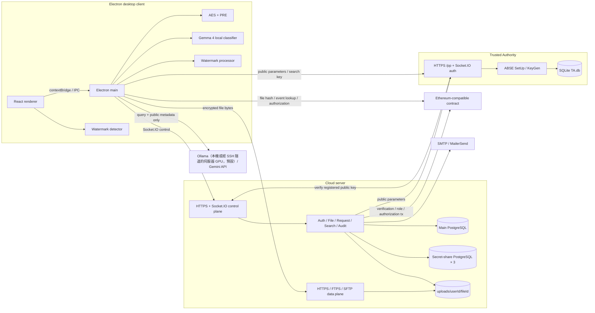
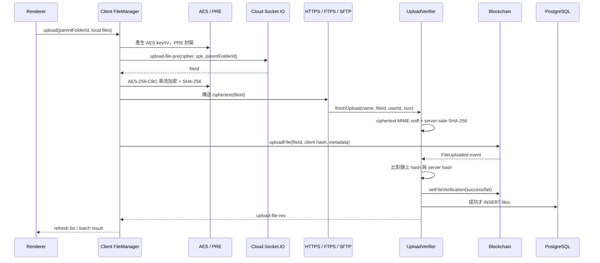
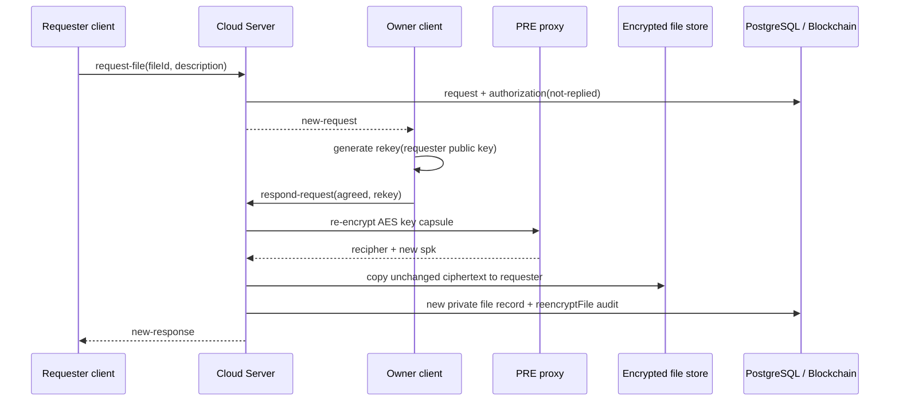
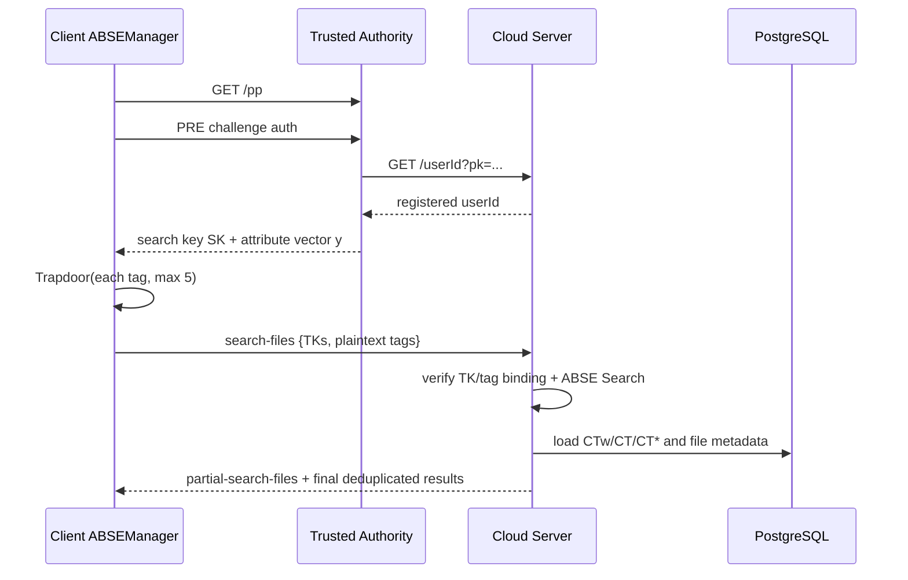
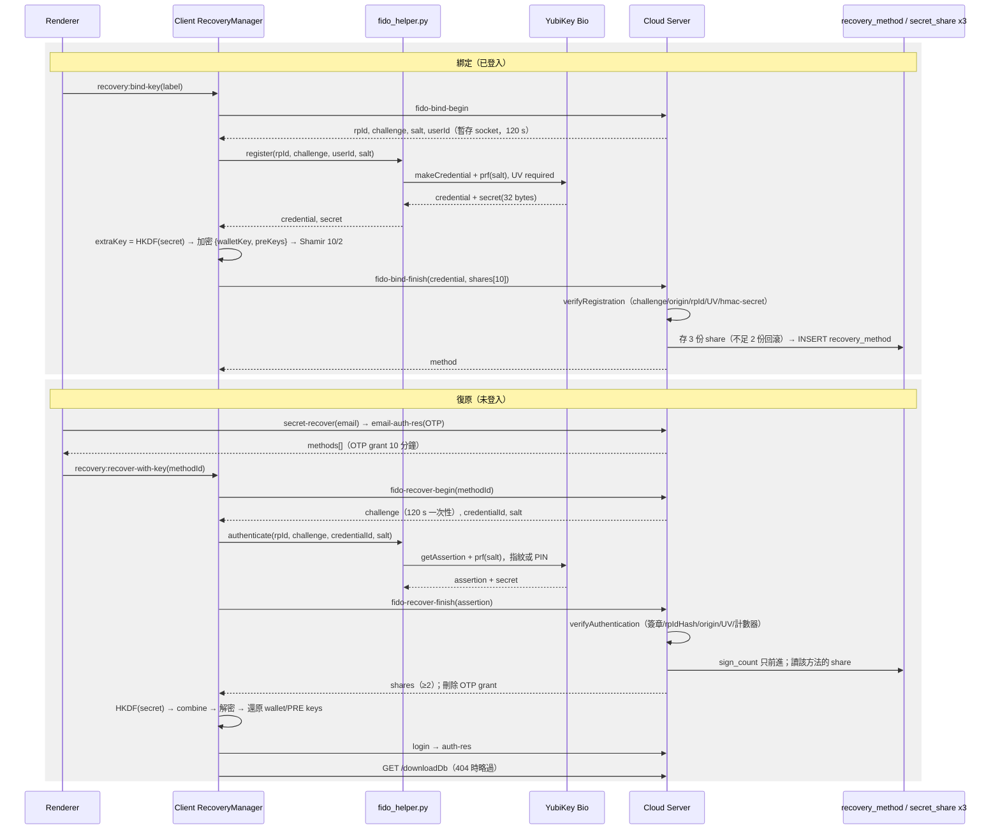
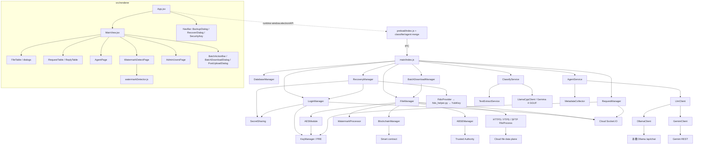
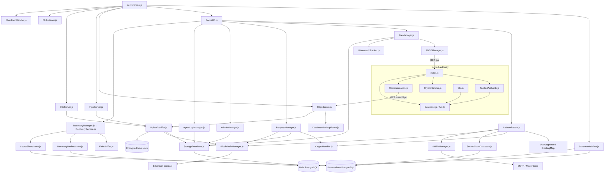

# Secure Cloud Storage（機敏雲端）

這是一套以桌面 Client 為入口的加密雲端儲存系統。檔案內容在 Electron Client 端先加密，Cloud Server 保存密文與 metadata；Ethereum 相容鏈保存檔案雜湊與授權紀錄；Trusted Authority（TA）管理 Attribute-Based Searchable Encryption（ABSE）公開參數、全域屬性與使用者搜尋金鑰。

> 本文件依 2026-10-29 工作目錄中的實際原始碼整理，包含尚未提交的 Server `DatabaseBackupRoute.js`/`test/backup/`、根目錄 `scripts/build-dmg.sh`、`scripts/tunnel.sh`，以及目前 Client 工作樹（`electron-builder.yml` 統一打包、智慧分類精簡為單一模型、macOS 離開前備份、Windows 建置指南等）。若既有子目錄 README、SQL 檔或建置產物與 `src/` 不一致，以目前 `src/` 執行路徑為準。這是架構與實作說明，不等同正式安全稽核報告。

快速導覽：[架構總覽](#架構總覽) · [功能與負責檔案](#目前功能與主要負責檔案) · [核心資料流](#核心資料流) · [Code graph](#code-graph) · [資料模型](#資料模型與儲存位置) · [對外介面](#對外介面) · [設定與啟動](#設定與本機啟動) · [AI 資料邊界](#ai-功能設定與資料邊界) · [安全模型](#安全模型與重要資產) · [已知限制](#已知限制與安全注意事項)

## 系統重點

- 檔案內容在 Client 以 AES-256-CBC 加密；隨機 AES key/IV 再以 Proxy Re-Encryption（PRE）封裝，Server 不必取得檔案明文即可協助分享。
- Server 以 `FileUploaded` event 的 hash 比對收到的密文，成功後再寫入 `FileVerified`；Client 下載時查詢兩種 event 並核對密文 SHA-256。正常下載目前實際依賴區塊鏈。
- Permission `1` 且具有非空 tags/CTw 的公開檔案可用 ABSE 加密索引與使用者屬性搜尋；TA 保存 ABSE master material，並依使用者屬性簽發搜尋金鑰。
- 支援檔案/資料夾 CRUD、多檔批次上傳與上傳後批次套用 metadata、多選與批次下載、存取申請、PRE 重加密分享、帳號備份復原（備份密碼或 FIDO2 指紋安全金鑰）、浮水印與下載稽核、管理員/使用者兩層權限與智慧搜尋對話紀錄稽核。
- 智慧分類使用本機 Gemma 4 E4B-it GGUF（Apache 2.0，與伺服器端 Gemma 4 31B 同家族），不送出檔案內容；智慧搜尋 Agent 預設使用 Ollama（`agent.provider: ollama`）：可以是本機 Ollama，正式/Demo 部署則是伺服器主機上的 GPU Ollama（`gemma4:31b-it-qat`、8k context，見 [`deploy/ollama/`](deploy/ollama/)），Client 經 SSH 隧道連到 `localhost:11435`，查詢與 metadata 只在隧道內往返自有主機、不經第三方；設定為 `gemini` 時才會將查詢、對話與篩選後的公開 metadata 送往 Gemini。每輪智慧搜尋對話都會保存到 Cloud Server（`agent_conversations`/`agent_messages`）供管理員稽核。
- Runtime 由三個獨立程式組成：Electron Client、Cloud Server、Trusted Authority，另依賴 PostgreSQL、Ethereum 相容節點/合約與可選的郵件服務。
- 部署：[`deploy/docker-compose.yml`](deploy/docker-compose.yml) 在單一主機啟動 Cloud Server、TA、PostgreSQL 16 與 GPU 版 Ollama（皆有 healthcheck）；主機對外只開 SSH，Client 以 SSH 隧道（macOS [`scripts/tunnel.sh`](scripts/tunnel.sh)、Windows 見 [`win_build.md`](secure-cloud-storage-client/win_build.md)）轉發 3001/2999/7001/11435。macOS 安裝檔由 [`scripts/build-dmg.sh`](scripts/build-dmg.sh) 產生。
- 測試：Server 以 `node --test` 覆蓋 FIDO2 驗證、復原服務、復原資料庫與 `/downloadDb`；Client 覆蓋 `FidoProvider` 與 `RecoveryManager`；另有 `scripts/admin_e2e.mjs`（管理員權限）與 `scripts/fido-e2e.mjs`（實體金鑰）實機腳本。其餘流程仍無自動化測試，見「已知限制」第 18 點。

## 架構總覽



### 三個主要元件

| 目錄 | 技術 | 職責 | 入口 |
|---|---|---|---|
| [`secure-cloud-storage-client/`](secure-cloud-storage-client/) | Electron 39、React 18、Node.js | UI、金鑰、檔案加解密、鏈上驗證、ABSE trapdoor、浮水印、本機分類與 Agent | [`src/main/index.js`](secure-cloud-storage-client/src/main/index.js)、[`src/renderer/src/App.jsx`](secure-cloud-storage-client/src/renderer/src/App.jsx) |
| [`secure-cloud-storage-server/`](secure-cloud-storage-server/) | Node.js ESM、Express 5、Socket.IO、PostgreSQL | Session、metadata、密文傳輸、上傳驗證、PRE proxy、請求、搜尋、稽核 | [`index.js`](secure-cloud-storage-server/index.js) |
| [`trusted-authority/`](trusted-authority/) | Node.js ESM、mcl-wasm、SQLite | ABSE 參數、全域屬性、使用者屬性與搜尋金鑰 | [`index.js`](trusted-authority/index.js) |

## 權限語意

權限常數定義於 [`Types.jsx`](secure-cloud-storage-client/src/renderer/src/components/Types.jsx)。目前語意如下：

| 值 | UI 名稱 | 公開 ABSE 搜尋 | 他人可提出檔案申請 | 說明 |
|---:|---|---|---|---|
| `0` | 私人 | 否 | 否 | 僅目前擁有者可操作與下載。 |
| `1` | 公開 | 是 | 是 | 更新 metadata 時可建立 ABSE 索引；公開搜尋只回傳此權限。 |
| `2` | 不公開 | 否 | 是 | 不會出現在公開搜尋，但知道 file UUID 的使用者仍可提出申請。 |

> 「公開」不等於可直接下載。非擁有者仍須提出申請，原擁有者同意後，Server 才會替申請人建立一份新的私人密文紀錄。

## 目前功能與主要負責檔案

| 功能 | 現行行為 | 主要負責檔案 |
|---|---|---|
| Electron 啟動與 IPC | 建立所有 manager、BrowserWindow、preload API、登入後首頁載入與程式生命週期。現行業務 UI 主要透過 `window.electronAPI` 呼叫 main；preload 另暴露 toolkit 的通用 `window.electron.ipcRenderer`，安全面仍應收斂。 | [`client/src/main/index.js`](secure-cloud-storage-client/src/main/index.js)<br>[`preload/index.js`](secure-cloud-storage-client/src/preload/index.js)<br>[`App.jsx`](secure-cloud-storage-client/src/renderer/src/App.jsx) |
| 使用者註冊與登入 | 以 PRE public key 送出登入/註冊；Server 回傳加密 challenge，Client 私鑰解密後回覆，藉此證明持有私鑰。註冊另包含姓名、Email、鏈上 address 與 Email OTP。 | [`client/LoginManager.js`](secure-cloud-storage-client/src/main/LoginManager.js)<br>[`client/KeyManager.js`](secure-cloud-storage-client/src/main/KeyManager.js)<br>[`server/Authentication.js`](secure-cloud-storage-server/src/Authentication.js)<br>[`server/UserLoginInfo.js`](secure-cloud-storage-server/src/UserLoginInfo.js) |
| PRE 與本機金鑰 | 首次啟動建立 PRE encryption/signing key pairs；支援 Level-1、Level-2 解密與 rekey 產生。PRE keys 和 blockchain wallet key 位於 Electron userData。 | [`KeyManager.js`](secure-cloud-storage-client/src/main/KeyManager.js)<br>[`BlockchainManager.js`](secure-cloud-storage-client/src/main/BlockchainManager.js)<br>[`CryptoHandler.js`](secure-cloud-storage-server/src/CryptoHandler.js) |
| 檔案/資料夾管理 | 目前資料夾列表、麵包屑導覽、建立/刪除空資料夾、刪檔、移動檔案、描述/權限/標籤/屬性更新。檔案列表可多選（`SelectionContext`：勾選欄、三態表頭對可見列全選；資料夾列停用），`BatchActionBar` 顯示已選數量/合計大小，但動作只有「批次下載」與「取消選取」；刪除、移動、metadata 編輯仍為單檔事件，Server 沒有任何批次事件。 | [`client/FileManager.js`](secure-cloud-storage-client/src/main/FileManager.js)<br>[`FileTable.jsx`](secure-cloud-storage-client/src/renderer/src/components/FileTable.jsx)<br>[`FileDetailDialog.jsx`](secure-cloud-storage-client/src/renderer/src/components/FileDetailDialog.jsx)<br>[`SelectionContext.jsx`](secure-cloud-storage-client/src/renderer/src/components/SelectionContext.jsx)<br>[`BatchActionBar.jsx`](secure-cloud-storage-client/src/renderer/src/components/BatchActionBar.jsx)<br>[`server/FileManager.js`](secure-cloud-storage-server/src/FileManager.js)<br>[`StorageDatabase.js`](secure-cloud-storage-server/src/StorageDatabase.js) |
| 加密上傳 | Client 以 AES-256-CBC 串流加密，PRE 封裝 AES key/IV，先以 Socket.IO 取得 file UUID，再用 HTTPS/FTPS/SFTP 傳密文；上傳與 hash 完成後送出鏈上交易。Client 上傳 queue concurrency 為 3，鏈上交易 queue 為 1。批次上傳以系統多選對話框選檔（不支援資料夾/拖放），每批有獨立 `batchId` 與 slot 計數（修掉舊版第二批覆蓋第一批、錯誤路徑不扣 slot 的問題），單檔失敗不影響其他檔；全部結束且至少一檔成功才送 `upload-batch-done` 開啟 `PostUploadDialog`。沒有 byte 級進度，每個成功檔各刷一次列表。 | [`client/FileManager.js`](secure-cloud-storage-client/src/main/FileManager.js)<br>[`AESModule.js`](secure-cloud-storage-client/src/main/AESModule.js)<br>[`FileUploadCoordinator.js`](secure-cloud-storage-client/src/main/FileUploadCoordinator.js)<br>[`HttpsFileProcess.js`](secure-cloud-storage-client/src/main/HttpsFileProcess.js)<br>[`FtpsFileProcess.js`](secure-cloud-storage-client/src/main/FtpsFileProcess.js)<br>[`SftpFileProcess.js`](secure-cloud-storage-client/src/main/SftpFileProcess.js) |
| 上傳後批次套用 metadata | `PostUploadDialog` 顯示智慧分類結果，讓使用者對整批一次設定標籤（≤5）、權限、屬性與說明（≤500 字）；確認後 main 以 `ask-batch-update-file-desc-perm` 對每個成功的 fileId **並行各送一次** `update-file-desc-perm`（ABSE `CTw` 只算一次），回報 `{succeeded, failed}` 後刷新一次列表；「略過」維持 Server 預設（permission 0、無標籤）。Server 沒有批次事件，單檔四段寫入（files/CTw/file_tags/file_attrs）也不在 transaction 內。 | [`PostUploadDialog.jsx`](secure-cloud-storage-client/src/renderer/src/components/PostUploadDialog.jsx)<br>[`uploadPostProcessIpc.js`](secure-cloud-storage-client/src/main/ipc/uploadPostProcessIpc.js)<br>[`client/FileManager.js`](secure-cloud-storage-client/src/main/FileManager.js)<br>[`server/FileManager.js`](secure-cloud-storage-server/src/FileManager.js) |
| Server 上傳驗證 | Server 對收到的**密文字節**做 MIME sniff、計算 SHA-256，等待 `FileUploaded` event，比對成功後送出 `setFileVerification` 並寫入 DB；逾時/不符則刪除檔案。這不是原始檔 malware/content scanning，且隨機密文仍可能誤撞 magic bytes。 | [`UploadVerifier.js`](secure-cloud-storage-server/src/UploadVerifier.js)<br>[`BlockchainManager.js`](secure-cloud-storage-server/src/BlockchainManager.js)<br>[`HttpsServer.js`](secure-cloud-storage-server/src/HttpsServer.js)<br>[`FtpsServer.js`](secure-cloud-storage-server/src/FtpsServer.js)<br>[`SftpServer.js`](secure-cloud-storage-server/src/SftpServer.js) |
| 單檔下載與完整性驗證 | 先取得 PRE capsule、擁有者與上鏈 block numbers，查指定 block 的 `FileVerified`/`FileUploaded`。下載串流同時計算 ciphertext SHA-256 並 AES 解密至 output path（浮水印流程使用暫存檔）；完成後才比對鏈上 hash，不符即刪除已寫入檔案，通過才保留/套浮水印。 | [`client/FileManager.js`](secure-cloud-storage-client/src/main/FileManager.js)<br>[`AESModule.js`](secure-cloud-storage-client/src/main/AESModule.js)<br>[`client/BlockchainManager.js`](secure-cloud-storage-client/src/main/BlockchainManager.js)<br>[`server/HttpsServer.js`](secure-cloud-storage-server/src/HttpsServer.js) |
| 批次下載 | 一次選目的資料夾（記在 localStorage `scs.batchDownload.destDir`），`BatchDownloadManager` 以順序迴圈逐檔處理（每批 concurrency 1，不同批次可同時進行），每檔各自走 `download-file-pre` → 鏈上 `FileVerified`/hash → 下載解密與 SHA-256 比對；同名檔以 Server 檔名加 `(2)`、`(3)`… suffix；取消只設旗標，當前檔（含浮水印）做完後其餘標 skipped。支援格式一律嵌不可視浮水印、可視只在「浮水印下載」模式，不支援格式純下載且不產生 `download_logs`。進度事件 `batch-download-progress`（batch-started/item-started/item-progress/item-done/batch-cancelled/batch-done）驅動右下角浮動卡片；無 byte 級進度，「在資料夾顯示」實作為開啟資料夾。 | [`BatchDownloadManager.js`](secure-cloud-storage-client/src/main/BatchDownloadManager.js)<br>[`BatchDownloadDialog.jsx`](secure-cloud-storage-client/src/renderer/src/components/BatchDownloadDialog.jsx)<br>[`BatchDownloadProgress.jsx`](secure-cloud-storage-client/src/renderer/src/components/BatchDownloadProgress.jsx) |
| 檔案存取申請 | Requester 針對公開/不公開檔案建立 request；Owner 可回覆、同意或拒絕。Client 白名單自動同意、黑名單自動拒絕 pending requests。 | [`client/RequestManager.js`](secure-cloud-storage-client/src/main/RequestManager.js)<br>[`server/RequestManager.js`](secure-cloud-storage-server/src/RequestManager.js)<br>[`RequestTable.jsx`](secure-cloud-storage-client/src/renderer/src/components/RequestTable.jsx)<br>[`ReplyTable.jsx`](secure-cloud-storage-client/src/renderer/src/components/ReplyTable.jsx) |
| PRE 分享 | Owner 同意時 Client 產生 requester-specific rekey。Server 只重加密 AES key capsule、複製原密文，以新 UUID 在 requester 名下建立 permission `0` 的檔案，並寫鏈上授權/重加密紀錄。 | [`client/RequestManager.js`](secure-cloud-storage-client/src/main/RequestManager.js)<br>[`KeyManager.js`](secure-cloud-storage-client/src/main/KeyManager.js)<br>[`server/RequestManager.js`](secure-cloud-storage-server/src/RequestManager.js)<br>[`CryptoHandler.js`](secure-cloud-storage-server/src/CryptoHandler.js) |
| ABSE metadata 與搜尋 | Permission `1` 且 tags 非空時，Client 才產生 CTw/CT/CT*；沒有 tags 的公開檔不具可搜尋索引。查詢時每個 tag 建立 trapdoor；Server 驗證 trapdoor 與明文 tag 的綁定後做 OR 搜尋、去重，回傳 permission `1` 且非本人擁有的結果。每次最多 5 tags。 | [`client/ABSEManager.js`](secure-cloud-storage-client/src/main/ABSEManager.js)<br>[`server/ABSEManager.js`](secure-cloud-storage-server/src/ABSEManager.js)<br>[`server/FileManager.js`](secure-cloud-storage-server/src/FileManager.js)<br>[`PublicTable.jsx`](secure-cloud-storage-client/src/renderer/src/components/PublicTable.jsx)<br>[`SearchBar.jsx`](secure-cloud-storage-client/src/renderer/src/components/SearchBar.jsx) |
| TA 搜尋金鑰 | Client 取得 `/pp` 後，以 PRE challenge 向 TA 證明已註冊且持有私鑰；TA 讀取 user attributes，建立向量 `y`，以 BLS12-381 `KeyGen` 回傳 ABSE search key。 | [`TA/index.js`](trusted-authority/index.js)<br>[`TrustedAuthority.js`](trusted-authority/src/TrustedAuthority.js)<br>[`TA/Database.js`](trusted-authority/src/Database.js)<br>[`TA/Communication.js`](trusted-authority/src/Communication.js) |
| 帳號備份與復原 | Client 將 wallet private key 與 PRE keys 以額外密碼衍生的 AES key 加密，再產生 10 份、threshold 2 的 Shamir shares；預設三個 share DB 各保存前 3 份中的一份。復原需 Email OTP、至少 2 份可用 share 與原額外密碼。另可綁定 FIDO2 安全金鑰（YubiKey Bio，每帳號最多 5 支）：金鑰在指紋/PIN 驗證後以 WebAuthn prf（hmac-secret）對 Server 給的 salt 算出固定 32 bytes 秘密值，`HKDF-SHA256(secret, info "secure-cloud-storage/recovery/fido-v1")` 導出 extraKey 取代額外密碼，碎片流程相同（秘密值用後歸零，從不離開 Client）。綁定：`fido-bind-begin`（challenge/salt 暫存 socket）→ python-fido2 helper 建立非常駐憑證（ES256/EdDSA、UV required、attestation none）→ `fido-bind-finish` 以 @simplewebauthn/server 驗證並要求 hmac-secret 擴充，碎片存入 share DB（不足 2 份回滾）後寫 `recovery_method`。復原：Email OTP 通過後 10 分鐘內（`recoverWindowMin`）選方法 → `fido-recover-begin`（challenge 120 秒、一次性）→ 金鑰一次按指紋同時產生簽章與秘密值 → `fido-recover-finish` 驗簽章、rpIdHash、origin、UV 與嚴格遞增的計數器（失敗 5 次作廢 OTP）才釋出該方法碎片，每次 OTP 只能成功一次。無指紋的金鑰（如 Idem Key）以 PIN 當 UV 同樣可用；App 內可設 PIN 與登錄指紋；未驗證 attestation/AAGUID。復原成功後還原金鑰並登入，本機 SQLite 備份改為選用（無備份只記 warn）；若另一台已登入則回 `LOGIN_FAILED`，金鑰已存檔、重開即自動登入。設計見 [`指紋復原計劃.md`](指紋復原計劃.md)，與計劃的差異見「核心資料流 6」。 | [`SecretSharing.js`](secure-cloud-storage-client/src/main/SecretSharing.js)<br>[`client/LoginManager.js`](secure-cloud-storage-client/src/main/LoginManager.js)<br>[`client/RecoveryManager.js`](secure-cloud-storage-client/src/main/RecoveryManager.js)<br>[`client/FidoProvider.js`](secure-cloud-storage-client/src/main/FidoProvider.js)<br>[`fido_helper.py`](secure-cloud-storage-client/resources/fido/fido_helper.py)<br>[`server/SecretShareDatabase.js`](secure-cloud-storage-server/src/SecretShareDatabase.js)<br>[`server/Authentication.js`](secure-cloud-storage-server/src/Authentication.js)<br>[`server/RecoveryService.js`](secure-cloud-storage-server/src/RecoveryService.js)<br>[`server/FidoVerifier.js`](secure-cloud-storage-server/src/FidoVerifier.js)<br>[`server/RecoveryMethodStore.js`](secure-cloud-storage-server/src/RecoveryMethodStore.js)<br>[`server/SecretShareStore.js`](secure-cloud-storage-server/src/SecretShareStore.js)<br>[`recoveryIpc.js`](secure-cloud-storage-client/src/main/ipc/recoveryIpc.js)<br>[`BackupDialog.jsx`](secure-cloud-storage-client/src/renderer/src/components/BackupDialog.jsx)<br>[`RecoverDialog.jsx`](secure-cloud-storage-client/src/renderer/src/components/RecoverDialog.jsx)<br>[`SecurityKey.jsx`](secure-cloud-storage-client/src/renderer/src/components/SecurityKey.jsx) |
| Client SQLite 備份 | 舊版 tags/attrs 已搬至 PostgreSQL，本機 SQLite 目前主要是相容/placeholder；關窗時仍以 PRE secret material 衍生 AES key 加密，上傳為使用者目錄的 `database.db`，復原時下載解密。本期修正：macOS 以 Cmd+Q 離開不會觸發 `window-all-closed`，改在 `before-quit` 先上傳備份（最多等 10 秒）；`recoverFromServer()` 改為先整份下載到記憶體解密、寫 `.restore` 暫存檔再 rename 覆蓋，404（新帳號無備份）回 `{restored:false, reason:'no-backup'}` 而非留下半寫的 SQLite；Server `GET /downloadDb` 抽成 `DatabaseBackupRoute.js`，無備份回 404 JSON 並附單元測試。 | [`DatabaseManager.js`](secure-cloud-storage-client/src/main/DatabaseManager.js)<br>[`HttpsServer.js`](secure-cloud-storage-server/src/HttpsServer.js)<br>[`DatabaseBackupRoute.js`](secure-cloud-storage-server/src/DatabaseBackupRoute.js) |
| 下載浮水印 | PDF、PNG、JPEG、DOCX、TXT 支援（以 magic bytes 判定，副檔名不符時以內容為準）。現行「原檔」模式對支援格式仍加入不可視追蹤資訊；「浮水印」模式加入可視與不可視內容。可視文字為 `uid:<8hex> \| fid:<fileId 前 8> \| <ISO ts>[ \| 自訂文字]`，不可視為 `uid:v1<完整 tracked UID> \| fid:<fileId> \| ts:<ISO>`（刻意不含自訂文字與姓名/Email）。載體：PDF 用 pdf-lib（可視 Helvetica 灰字、透明度 0.3、字級 14、右下/左下/45° 重複；不可視 Keywords + 每頁 opacity 0 平鋪文字，非 object stream 儲存），PNG 用 Jimp（可視白色點陣字；不可視 R 通道 LSB + `tEXt` `scs-wm-inv/vis`），JPEG 只用 `COM` 註解段、可視模式才重編碼（q95），DOCX 用 JSZip 改 XML（可視文末段落；不可視覆寫 `docProps/custom.xml`），TXT 檔尾附加（可視 `# Watermark:` 行；不可視零寬字元 ZWSP/ZWJ，非 UTF-8 檔退回附加可視行）。Server 看不到解密後檔案，實際轉換在 Client。 | [`WatermarkProcessor.js`](secure-cloud-storage-client/src/main/WatermarkProcessor.js)<br>[`DownloadOptionsDialog.jsx`](secure-cloud-storage-client/src/renderer/src/components/DownloadOptionsDialog.jsx)<br>[`server/FileManager.js`](secure-cloud-storage-server/src/FileManager.js) |
| 浮水印下載稽核 | Server 以 server-only `certs/watermark.key`（32 bytes，首次啟動自動產生）產生 tracked UID：`v1` + 32 hex IV + 96 hex 密文共 130 字元，payload 只有下載者 userId；IV = HMAC-SHA256(key, userId) 前 16 bytes（同一使用者永遠同一 UID），密文 = AES-256-CBC；解碼時以解出的 userId 重算 IV 做常數時間比對，不符即視為竄改。可視浮水印只放去掉 `v1` 後的前 8 hex，Server 以 O(N) 重算全部使用者的 UID 比對前綴。流程：`download-file-with-watermark` 建立 socket-bound pending request（含 ts、payloadHash，TTL 10 分鐘、每分鐘清掃）→ Client 落盤後 `confirm-watermark-download`（single-use，先 delete 再比 socket）→ 只有 success 才寫 `download_logs`（downloader、owner、mode、可視/不可視旗標、payloadHash、commit 時間）。payloadHash 回給 Client 但未嵌入也未在 UI 驗證。 | [`WatermarkTracker.js`](secure-cloud-storage-server/src/WatermarkTracker.js)<br>[`server/FileManager.js`](secure-cloud-storage-server/src/FileManager.js)<br>[`StorageDatabase.js`](secure-cloud-storage-server/src/StorageDatabase.js) |
| 浮水印追蹤/鑑識（管理員） | Renderer 本機解析 PDF keywords/text layer（依 y 聚類拼回整行）、PNG 的 `tEXt`/R-channel LSB、JPEG `COM` metadata（detector 仍 best-effort 試 LSB）、DOCX custom property/body XML、TXT marker/zero-width chars，可視與不可視 finding 都列出；**不可視且為完整 `v1...`** 的 tracked UID 才自動送 Server 驗證，可視的 8 hex 前綴需手動按「查詢來源使用者」；沒有 `v1` 前綴或 Server 解碼失敗則標示「遭竄改」。檔案 bytes 不會為偵測而上傳。頁面與 `decode-watermark-uid` 皆限 `users.role = admin`；解出使用者後同頁列出其最近 200 筆 `download_logs`（`admin-user-download-logs`：時間、檔案、模式、浮水印），形成「外流檔案 → 下載者 → 何時下載哪個檔」的追溯鏈；清單未依浮水印中的 `fid` 過濾，需管理員自行比對。 | [`watermarkDetector.js`](secure-cloud-storage-client/src/renderer/src/watermarkDetector.js)<br>[`WatermarkDetectPage.jsx`](secure-cloud-storage-client/src/renderer/src/components/WatermarkDetectPage.jsx)<br>[`WatermarkTracker.js`](secure-cloud-storage-server/src/WatermarkTracker.js) |
| 本機智慧分類 | 上傳前以「智慧標籤」開關啟用（只有開/關，存 localStorage，開啟時固定使用本機 Gemma 4 E4B-it Q4_K_M GGUF）。選檔當下快照開關並在背景啟動分類，與上傳並行（結果放 LRU 快取 50 筆/30 分鐘，進度以 `preupload-classify-status` 推給工具列 spinner，單位是推論「組」）。從 TXT/MD/PDF/DOCX 擷取文字（pdf-parse 退 pdfjs、mammoth），每組 ≤16 檔/約 3,000 字，node-llama-cpp（≥3.19，Gemma 4 架構支援）以 JSON grammar 強制輸出六標籤分數（海軍、陸軍、空軍、聯合作戰、演訓戰備、其他）與依據，system prompt 不帶 `<|think|>` 故 thinking 關閉、temperature 0.1、單次 90 秒 timeout、context 從 2048/4096/8192 選最小可容納者；多組取每標籤最高分，final labels = 分數 ≥ 0.55 且有依據。上傳完成後由使用者在 `PostUploadDialog` 確認（可改門檻 0.35–0.75 重試）並批次套用 metadata。 | [`ClassifyService.js`](secure-cloud-storage-client/src/main/services/ClassifyService.js)<br>[`TextExtractService.js`](secure-cloud-storage-client/src/main/services/TextExtractService.js)<br>[`LlamaCppClient.js`](secure-cloud-storage-client/src/main/services/LlamaCppClient.js)<br>[`PostUploadDialog.jsx`](secure-cloud-storage-client/src/renderer/src/components/PostUploadDialog.jsx) |
| 管理員權限與稽核 | `users.role`（`admin`/`user`）於登入時讀入 `socket.role`，Server 端 `checkAdmin` 把關所有 `admin-*` 事件與 `decode-watermark-uid`；管理員來源為 Server `admin.emails`（啟動與註冊時自動設定）、`npm run set-admin`（終端指令，即時生效）或直接改 DB。管理員頁「使用者管理」列出所有使用者（角色、狀態、檔案數），唯一動作是「下載對話紀錄」：main 以 `admin-export-conversations` 取回後寫成 JSON。匯出是**跨 session 攤平的單一訊息陣列**（`messages`，依寫入順序由舊到新，依訊息 id 去重，每則帶 `conversationId`/`provider` 可回溯是哪一次使用），另有 `messageCount`/`sessionCount`；單次上限 5000 則，超過時保留最新的。NavBar 只對 admin 顯示管理頁籤，真正邊界在 Server。 | [`AdminManager.js`](secure-cloud-storage-server/src/AdminManager.js)<br>[`set-admin.mjs`](secure-cloud-storage-server/scripts/set-admin.mjs)<br>[`server/Utils.js`](secure-cloud-storage-server/src/Utils.js)<br>[`adminIpc.js`](secure-cloud-storage-client/src/main/ipc/adminIpc.js)<br>[`AdminUsersPage.jsx`](secure-cloud-storage-client/src/renderer/src/components/AdminUsersPage.jsx)<br>[`NavBar.jsx`](secure-cloud-storage-client/src/renderer/src/components/NavBar.jsx) |
| 智慧搜尋 Agent（Ollama/Gemini） | Renderer 在每次送出查詢前以 `agent:file-scope` 重新取得專用清單（Server `get-agent-file-scope`：自己的全部檔案 + 其他人的公開檔案，附 ownerName、tags 與自己的資料夾清單，非自己檔案不帶 cipher/spk）交給 main；Ollama provider 可搜尋清單內全部（含私人）檔案，Gemini provider 依 `perm===1` 只篩公開 metadata。LLM 先把自然語言轉成 JSON filter（欄位：name/desc/uploader_name/folder_path `.contains`、`file_type`、`tags.any/all/none`、`is_public`、`is_own`、`date`、`size`、`any_text`；解析後有 dotted-key 正規化）；本機 JS hard-filter/rank（tag 命中 +12、檔名 +7、時近 +5/+3/+1）取 top 20，再由 LLM 以繁中 3–5 句摘要。LLM 失敗時退回本機 keyword search（去停用詞）。Provider 由 `agent.provider` 決定：預設 `ollama`（`agent.ollama.url` 預設 `http://localhost:11434`；`default.yaml` 目前指定 `model: gemma4-31b-8k:latest`，留空才自動選用 gemma 優先的已安裝模型；`num_ctx` 8192、`think:false`），設為 `gemini`（`gemini-3-flash-preview`）才走 Gemini API；兩者 fetch 都沒有 timeout。此 public-only gate 沒有向 Server 重新取資料/授權。每輪對話（使用者訊息、回覆、命中檔案 ID ≤100、provider）以 `agent-log` 保存於 Server（單則截到 `agentLogMaxChars` 8000），App 啟動後首次取得 userId 時以 `agent-my-history` 回填最近一段對話供顯示與模型上下文（不還原檔案卡片），但**不沿用該 conversation id**：每次啟動與每次清除對話都會開新的 conversation，稽核紀錄因此以單次使用為單位分段，不會累積成跨日的單一紀錄。 | [`AgentService.js`](secure-cloud-storage-client/src/main/services/AgentService.js)<br>[`MetadataCollector.js`](secure-cloud-storage-client/src/main/services/MetadataCollector.js)<br>[`LlmClient.js`](secure-cloud-storage-client/src/main/services/LlmClient.js)<br>[`OllamaClient.js`](secure-cloud-storage-client/src/main/services/OllamaClient.js)<br>[`GeminiClient.js`](secure-cloud-storage-client/src/main/services/GeminiClient.js)<br>[`AgentPage.jsx`](secure-cloud-storage-client/src/renderer/src/components/AgentPage.jsx)<br>[`AgentLogManager.js`](secure-cloud-storage-server/src/AgentLogManager.js) |
| Schema 與資料庫啟動 | Server 啟動時以 idempotent DDL 建立/補齊主 DB 與 secret-share DB schema；主 DB 失敗會中止，個別 share DB 失敗只警告。 | [`SchemaInitializer.js`](secure-cloud-storage-server/src/SchemaInitializer.js)<br>[`StorageDatabase.js`](secure-cloud-storage-server/src/StorageDatabase.js)<br>[`SecretShareDatabase.js`](secure-cloud-storage-server/src/SecretShareDatabase.js) |
| 管理與日誌 | Cloud CLI 可看使用者、線上狀態、檔案、requests/responses，並啟用/停用/刪除/更新帳號；TA CLI 管理全域與使用者屬性。Server CLI 透過 mode `0600` 的 `/tmp/log.sock` 取得線上資料與寫管理 log。 | [`server/CLI.js`](secure-cloud-storage-server/CLI.js)<br>[`CLIListener.js`](secure-cloud-storage-server/src/CLIListener.js)<br>[`TA/CLI.js`](trusted-authority/CLI.js)<br>[`Logger.js`](secure-cloud-storage-server/src/Logger.js) |

## 使用者介面

Renderer 的七個主要頁面由 [`MainView.jsx`](secure-cloud-storage-client/src/renderer/src/components/MainView.jsx) 切換：

1. **智慧搜尋**：對自己全部檔案與他人公開檔案的 metadata 做自然語言查詢（Gemini provider 只含公開檔案）。
2. **公開列表**：輸入至多五個 tag，以 ABSE trapdoor 搜尋；它是「搜尋結果頁」，不是自動列出所有公開檔案。
3. **檔案列表**：個人檔案/資料夾、上傳、選取、批次下載、移動、刪除與 metadata 編輯。
4. **回覆列表**：本人提出的申請及 Owner 的回覆。
5. **請求列表**：別人對本人檔案提出的申請、同意/拒絕與黑白名單。
6. **浮水印追蹤**（管理員）：本機檢查可視/不可視標記、顯示 payload、解出下載者並列出其下載紀錄。
7. **使用者管理**（管理員）：列出所有使用者（角色、狀態、檔案數、對話數），下載任一使用者的智慧搜尋對話紀錄 JSON。

帳號註冊/資訊、備份/復原為 NavBar 對話框；主要元件在 [`RegisterDialog.jsx`](secure-cloud-storage-client/src/renderer/src/components/RegisterDialog.jsx)、[`ProfileDialog.jsx`](secure-cloud-storage-client/src/renderer/src/components/ProfileDialog.jsx)、[`BackupDialog.jsx`](secure-cloud-storage-client/src/renderer/src/components/BackupDialog.jsx)、[`RecoverDialog.jsx`](secure-cloud-storage-client/src/renderer/src/components/RecoverDialog.jsx)。

## 核心資料流

### 1. 登入與註冊

1. Client 載入或建立 PRE key pairs 與 blockchain wallet。
2. `login`/`register` 將 PRE public key 送至 Cloud Server。
3. Server 產生隨機 challenge，以該 public key 加密後回傳 `{ cipher, spk }`。
4. **登入**：Client 以 PRE private key 解密並送出 `auth-res`；成功後 session 才綁定 Socket.IO socket。
5. **註冊**：`auth-res` 驗證成功後仍要完成 Email OTP、DB user/root folder 建立；Client 之後再走一次 login 才取得 session。Server 會非同步嘗試設定鏈上 client role，登入時另以 `ensureClientRole` 補償，該交易不是註冊成功的同步保證。
6. Client 以相似 challenge 向 TA 證明 key ownership，取得自己的 ABSE search key。

### 2. 加密上傳與鏈上驗證



若 `blockchain.enabled=false`，Server 會略過鏈上比對並直接寫 DB；但 Client 正常下載路徑仍要求鏈上驗證，因此目前停用模式不是完整可運作的 end-to-end 模式。

### 3. 下載、驗證與浮水印

```mermaid
sequenceDiagram
  participant UI as Renderer
  participant C as Client FileManager
  participant S as Cloud Server
  participant B as Blockchain
  participant K as PRE / AES
  participant W as WatermarkProcessor

  UI->>C: download(fileId, mode)
  C->>S: download-file-pre
  S-->>C: cipher/spk/owner/size/block numbers
  C->>B: query FileVerified + FileUploaded at recorded blocks
  opt PDF / PNG / JPEG / DOCX / TXT
    C->>S: download-file-with-watermark(fileId, mode='watermark' hard-coded)
    S-->>C: requestId + server-issued watermarkMeta
  end
  C->>K: PRE L1/L2 unwrap AES key/IV
  C->>S: GET encrypted file
  S-->>C: ciphertext stream
  par integrity stream
    C->>C: SHA-256(ciphertext)
  and decrypt stream
    C->>K: AES decrypt to output path (watermark flow uses temp)
  end
  C->>C: completed hash == on-chain hash; otherwise delete temp
  opt PDF / PNG / JPEG / DOCX / TXT
    C->>W: invisible always; visible only in watermark mode
    C->>S: confirm-watermark-download(success/failure)
    S->>S: success 才寫 download_logs
  end
  C-->>UI: file saved / progress / error notice
```

### 4. 檔案申請與 PRE 分享



拒絕時不建立檔案，鏈上授權狀態記為 `rejected`。

### 5. ABSE 搜尋



ABSE 保護的是搜尋索引與屬性匹配流程；目前 `file_tags`、`file_attrs` 仍以明文存在 PostgreSQL，而且搜尋 request 也包含明文 tags，因此不可把現況描述為「Server 完全不知道關鍵字」。

### 6. 指紋帳號復原（綁定與復原）



與 [`指紋復原計劃.md`](指紋復原計劃.md) 的差異：Server 在 `fido-bind-begin` 只把 challenge/salt 放在 socket 記憶體，`fido-bind-finish` 驗證通過後才寫 DB；秘密值走 WebAuthn prf 層，金鑰實際 HMAC 的 salt 是 `SHA-256("WebAuthn PRF\0" ‖ salt)`；無指紋金鑰以 PIN 當 UV 即可用（Idem Key 備援已隱含支援）；UI 不強制保留密碼法，只在沒有密碼備份且金鑰少於 2 支時提醒；未驗證 attestation/AAGUID。Server 參數見 `config/default.yaml` 的 `fido` 區段；Python helper 以 newline-delimited JSON 經 stdin/stdout 溝通，每次操作 spawn 一次、整體逾時 120 秒。

## Code graph

### Client 核心執行時呼叫圖



### Cloud Server 與 TA 模組依賴



### 重要檔案索引

#### Client main/preload

| 檔案 | 主要責任 |
|---|---|
| [`src/main/index.js`](secure-cloud-storage-client/src/main/index.js) | Composition root、Window/lifecycle、一般 IPC。 |
| [`GlobalValueManager.js`](secure-cloud-storage-client/src/main/GlobalValueManager.js) | `node-config`、userData paths、session/UI global state 與通知。 |
| [`MessageManager.js`](secure-cloud-storage-client/src/main/MessageManager.js) | Socket.IO 單例、reconnect 後重新登入。 |
| [`FileManager.js`](secure-cloud-storage-client/src/main/FileManager.js) | 上下載、CRUD、搜尋、metadata、ABSE 與浮水印 orchestration。 |
| [`RequestManager.js`](secure-cloud-storage-client/src/main/RequestManager.js) | 檔案申請/回覆、auto allow/deny、rekey。 |
| [`KeyManager.js`](secure-cloud-storage-client/src/main/KeyManager.js) | PRE/signing key lifecycle、Level-1/2 解密與 rekey。 |
| [`BlockchainManager.js`](secure-cloud-storage-client/src/main/BlockchainManager.js) | Wallet、合約交易、事件查詢、UUID/uint128 轉換。 |
| [`ABSEManager.js`](secure-cloud-storage-client/src/main/ABSEManager.js) | MCL 初始化、TA `/pp`/search key、`Enc`/`Trapdoor`。 |
| [`WatermarkProcessor.js`](secure-cloud-storage-client/src/main/WatermarkProcessor.js) | 五種格式的可視/不可視轉換。 |
| [`BatchDownloadManager.js`](secure-cloud-storage-client/src/main/BatchDownloadManager.js) | 批次下載順序迴圈、撞名、取消與進度事件。 |
| [`FidoProvider.js`](secure-cloud-storage-client/src/main/FidoProvider.js) | spawn `fido_helper.py`、NDJSON 協定、PIN 往返、錯誤碼、HKDF 導出 extraKey。 |
| [`RecoveryManager.js`](secure-cloud-storage-client/src/main/RecoveryManager.js) | 綁定/復原流程：rpId 驗證、碎片加解密、與 Server 事件往返。 |
| [`ipc/recoveryIpc.js`](secure-cloud-storage-client/src/main/ipc/recoveryIpc.js) | 復原相關 IPC（bind/recover/set-pin/enroll/info）與 PIN 請求轉送。 |
| [`DatabaseManager.js`](secure-cloud-storage-client/src/main/DatabaseManager.js) | 本機 SQLite 加密備份上傳與還原（`.restore` 暫存後 rename）。 |
| [`services/ClassifyService.js`](secure-cloud-storage-client/src/main/services/ClassifyService.js) | 智慧標籤：抽取、分組、prompt、合併與門檻。 |
| [`services/LlamaCppClient.js`](secure-cloud-storage-client/src/main/services/LlamaCppClient.js) | node-llama-cpp 模型/context 單例、grammar、token 預算與 timeout。 |
| [`services/AgentService.js`](secure-cloud-storage-client/src/main/services/AgentService.js) | 智慧搜尋四階段：解析 → 過濾 → 排序 → 摘要，與 keyword fallback。 |
| [`preload/index.js`](secure-cloud-storage-client/src/preload/index.js) | Renderer 可使用的 contextBridge API。 |

#### Cloud Server

| 檔案 | 主要責任 |
|---|---|
| [`index.js`](secure-cloud-storage-server/index.js) | 入口、schema 初始化、FTPS listen 與 blockchain diagnosis。 |
| [`SocketIO.js`](secure-cloud-storage-server/src/SocketIO.js) | 共用 HTTPS server、Socket.IO 與 binder 掛載。 |
| [`Authentication.js`](secure-cloud-storage-server/src/Authentication.js) | Login/register challenge、OTP、secret recovery。 |
| [`FileManager.js`](secure-cloud-storage-server/src/FileManager.js) | File/folder/search/watermark Socket.IO handlers。 |
| [`RequestManager.js`](secure-cloud-storage-server/src/RequestManager.js) | Request lifecycle 與 PRE 分享。 |
| [`UploadVerifier.js`](secure-cloud-storage-server/src/UploadVerifier.js) | Pending upload、MIME/hash/chain event 驗證與 rollback。 |
| [`StorageDatabase.js`](secure-cloud-storage-server/src/StorageDatabase.js) | PostgreSQL query layer、PII encryption、tags/attrs/audit log。 |
| [`SchemaInitializer.js`](secure-cloud-storage-server/src/SchemaInitializer.js) | Idempotent runtime schema 與有限度自動 bootstrap。 |
| [`WatermarkTracker.js`](secure-cloud-storage-server/src/WatermarkTracker.js) | Server-only tracked UID key、編解碼與 prefix lookup。 |
| [`RecoveryManager.js`](secure-cloud-storage-server/src/RecoveryManager.js) | 綁定 `fido-*`/`recovery-*` Socket.IO 事件到 `RecoveryService`，錯誤包裝。 |
| [`RecoveryService.js`](secure-cloud-storage-server/src/RecoveryService.js) | 綁定/復原狀態機：socket 暫存 challenge、OTP grant、上限、碎片存取與回滾。 |
| [`FidoVerifier.js`](secure-cloud-storage-server/src/FidoVerifier.js) | 以 @simplewebauthn/server 驗證註冊/斷言、hmac-secret 擴充、計數器。 |
| [`RecoveryMethodStore.js`](secure-cloud-storage-server/src/RecoveryMethodStore.js)、[`SecretShareStore.js`](secure-cloud-storage-server/src/SecretShareStore.js)、[`RecoverySchema.js`](secure-cloud-storage-server/src/RecoverySchema.js) | `recovery_method` 與 `secret_share(method_id)` 的 DDL/升級 SQL 與存取層。 |
| [`AdminManager.js`](secure-cloud-storage-server/src/AdminManager.js)、[`AgentLogManager.js`](secure-cloud-storage-server/src/AgentLogManager.js) | 管理員事件（使用者列表、對話匯出、下載紀錄）與智慧搜尋對話寫入/回填。 |
| [`DatabaseBackupRoute.js`](secure-cloud-storage-server/src/DatabaseBackupRoute.js) | `GET /downloadDb` handler（無備份回 404），可獨立測試。 |
| [`Validation.js`](secure-cloud-storage-server/src/Validation.js) | Zod 輸入 schemas。 |

#### Trusted Authority

| 檔案 | 主要責任 |
|---|---|
| [`index.js`](trusted-authority/index.js) | TLS server、`GET /pp`、Socket.IO `auth`/`auth-res`。 |
| [`TrustedAuthority.js`](trusted-authority/src/TrustedAuthority.js) | BLS12-381 ABSE `SetUp`、parameter serialization、`KeyGen`。 |
| [`Database.js`](trusted-authority/src/Database.js) | SQLite schema、master/public parameters、global/user attributes。 |
| [`CryptoHandler.js`](trusted-authority/src/CryptoHandler.js) | PRE challenge 產生。 |
| [`Communication.js`](trusted-authority/src/Communication.js) | 向 Cloud Server `/userId` 驗證 public key 已註冊。 |
| [`CLI.js`](trusted-authority/CLI.js) | 新增/改名全域屬性、設定使用者屬性。 |

## 資料模型與儲存位置

### Cloud 主 PostgreSQL

真正的 runtime schema 來源是 [`SchemaInitializer.js`](secure-cloud-storage-server/src/SchemaInitializer.js)；[`database.sql`](secure-cloud-storage-server/database.sql) 和 [`sharedb.sql`](secure-cloud-storage-server/sharedb.sql) 是舊式/手動參考，未完整包含目前欄位與 `download_logs`。

| Table | 用途 |
|---|---|
| `users` | UUID、PRE public key、blockchain address、加密後 name/email、status、role（`admin`/`user`，預設 `user`）。 |
| `folders` | Owner、parent folder、permission、名稱。 |
| `files` | Owner/origin owner、filename、permission、PRE `cipher/spk`、folder、size、description、鏈上 info/verify block number。 |
| `requests`, `responses` | 存取申請、同意/拒絕與文字回覆。 |
| `ctw_table`, `ct_table`, `ctstar_table` | ABSE encrypted searchable index components。 |
| `file_tags`, `file_attrs` | 明文 tag 與 attribute ID。 |
| `download_logs` | Downloader、owner、mode（目前永遠 `watermark`）、可視/不可視 flags、payload hash、`requestid`（目前 NULL）、時間（confirm 時間）；無 FK/索引。 |
| `agent_conversations`, `agent_messages` | 智慧搜尋對話：每段對話一筆（owner、provider、起訖時間），每則訊息一筆（role、明文 content、命中檔案 ID、`seq` 排序）。 |
| `recovery_method` | 綁定的安全金鑰：credential ID、COSE public key、簽章計數器、hmac-secret salt、AAGUID、名稱與使用時間。都不是秘密，碎片在 share DB 以同一個 id 分組。 |

檔案密文不放 PostgreSQL，而是存成：

```text
secure-cloud-storage-server/<uploads>/<owner-user-id>/<file-id>
```

原始檔名只在 metadata 中；實體 blob 名稱為 file UUID。分享時會把同一密文複製到新 owner 目錄，並換成新的 UUID 與 PRE capsule。

### Secret shares

預設 `secret_share1`、`secret_share2`、`secret_share3` 三個 PostgreSQL DB 各有：

```text
secret_share(userid, method_id, share, retrievable)   -- PRIMARY KEY (userid, method_id)
```

`method_id` 為 `password`（額外密碼備份）或 `recovery_method.id`（安全金鑰），每個方法各一組碎片。舊版以 `userid` 為主鍵的表會在 Server 啟動時自動升級，既有資料歸為 `password`；還原 SQL 見 [`sharedb.sql`](secure-cloud-storage-server/sharedb.sql)。讀取時個別 DB 失敗會被容忍；實際復原仍至少需要 Shamir threshold 的 2 份 share。

### Trusted Authority SQLite

`trusted-authority/data/TA.db` 包含：

| Table | 用途 |
|---|---|
| `params` | ABSE `alpha`, `beta`, `g1`, `g2`, `eggalpha`, `h`。 |
| `array_params` | 屬性名稱、秘密 scalar `s`、公開 `h_i` 與保留 `EOF` slot。 |
| `user_attr` | user UUID 與 attribute ID 的多對多映射。 |

首次 setup 的預設屬性為「機密、極機密、絕對機密」，其餘 slot 為 `None`；數量由 `ATTR_NUM` 決定（預設 32），另有一個系統保留位置。`TA.db` 含 master secret，必須視為高敏感資產並持久化備份。

### Client 本機資料

Electron userData 主要包含：

- `user.keys`：PRE encryption/signing private/public keys。
- `wallet.key`：blockchain wallet private key。
- `database.db`：目前主要為相容用的 SQLite。
- `config/local.yaml`：使用者/instance 覆寫設定與部分 UI 狀態。
- Client logs。

Linux 預設約在 `~/.config/client-side`，Windows 約在 `%APPDATA%/client-side`；macOS 由 Electron `app.getPath('userData')` 決定。不要把這些 runtime secrets 提交到版本控制。

### 鏈上資料

Client 上傳呼叫會包含 file UUID、密文 hash 與 filename metadata；Server 另寫 verification、client status 與 authorization/re-encryption 紀錄。鏈上資料通常不可刪除，部署前應確認 filename/metadata 的隱私需求。

## 對外介面

### 預設 Port

| Service | Port | 說明 |
|---|---:|---|
| Cloud HTTPS + Socket.IO | `3001` | 同一 TLS server。 |
| Cloud SFTP | `7001` | SSH host key：`ssh/id_ed25519`。 |
| Cloud FTP/explicit FTPS control | `7002` | Passive data port 固定 `7000`。 |
| Cloud FTP passive data | `7000` | 部署時需一併開放並設定正確 public address。 |
| Trusted Authority HTTPS + Socket.IO | `2999` | `/pp` 與 TA auth。 |
| PostgreSQL | `5432` | 預設值，可由設定覆寫。 |

### Cloud HTTPS routes

| Method/path | 驗證 | 用途 |
|---|---|---|
| `POST /upload` | `socketid` + `fileid` headers | Multipart 上傳密文；目前 HTTPS 上限為 8,000,000 bytes。 |
| `GET /download` | `socketid` + `fileid` headers | 僅下載目前登入者擁有的密文。 |
| `POST /uploadDb` | `socketid` | 上傳 Client 加密 SQLite backup；共用相同 Multer instance，因此也是 8,000,000 bytes 上限。 |
| `GET /downloadDb` | `socketid` | 下載 Client 加密 SQLite backup；尚無備份（新帳號）時回 `404 {"errorMsg":"No database backup."}` 而非 500（[`DatabaseBackupRoute.js`](secure-cloud-storage-server/src/DatabaseBackupRoute.js)，可獨立測試）。 |
| `GET /userId?pk=...` | 無登入驗證 | TA 以 PRE public key 查 Cloud user UUID。 |

### 主要 Socket.IO event groups

| 領域 | Client → Server | Server → Client / callback |
|---|---|---|
| Auth | `login`, `register`, `auth-res`, `email-auth-res`, `secret-share`, `secret-recover` | challenge、user info（含 `role`）、shares/error；復原的 `email-auth-res` 另回 `methods`。 |
| Security-key recovery | 登入後：`recovery-methods`, `fido-bind-begin`, `fido-bind-finish`, `recovery-method-delete`；Email OTP 後：`fido-recover-begin`, `fido-recover-finish` | challenge（一次性、120 秒）與 salt、method、該方法的 shares/error。 |
| Files | `upload-file-pre`, `download-file-pre`, `delete-file`, `get-file-list`, `add-folder`, `delete-folder`, `get-all-folders`, `move-file`, `update-file-desc-perm`, `get-agent-file-scope` | `upload-file-res`、lists/result。 |
| Search | `search-files` | `partial-search-files`、final result。 |
| Requests | `request-file`, `delete-request`, `respond-request`, `get-request-list`, `get-requested-list` | `new-request`, `new-response`、lists/result。 |
| Watermark | `download-file-with-watermark`, `confirm-watermark-download`, `decode-watermark-uid`（admin） | request/meta、commit result、identity matches。 |
| Agent log / Admin | `agent-log`, `agent-my-history`, `admin-list-users`, `admin-export-conversations`, `admin-user-download-logs` | ok/conversations、users、`{ user, messageCount, sessionCount, messages[] }`、logs；`admin-*` 需 `users.role = admin`。 |

TA 另提供 `GET /pp`，以及 Socket.IO `auth` → `auth-res` challenge flow。

## 設定與本機啟動

### 先決條件

- 建議 Node.js 22 LTS。專案沒有宣告 `engines`；部分 lockfile dependencies 至少要求 Node 20.12，TA Docker image 使用 Node 22。
- npm。
- 可連線的 PostgreSQL。
- Ethereum 相容 JSON-RPC、已部署且 ABI 相符的 storage contract、Server 與各 Client wallet。
- Cloud Server 與 TA 的 TLS key/certificate。
- 若使用 SFTP，需要 Server SSH Ed25519 host key。
- Production 註冊/復原需要 SMTP 或 MailerSend。
- 指紋帳號復原需要 Client 端 Python 3.10+ 與 `fido2` 套件（`pip3 install "fido2>=2.2"`），以及支援 hmac-secret 的 FIDO2 安全金鑰，例如 YubiKey Bio；到貨驗證可跑 `python3 scripts/fido_spike.py`。Windows 上 Client 預設執行 `python3`，python.org 安裝版只有 `python`/`py`，需以環境變數 `SCS_FIDO_PYTHON` 指定 `python.exe` 完整路徑；且 Windows 只允許系統管理員權限的程式直接存取 FIDO 裝置，綁定/復原金鑰時必須「以系統管理員身分執行」Client（詳見 [`win_build.md`](secure-cloud-storage-client/win_build.md)）。
- 本機分類需要另外配置 Gemma 4 E4B-it GGUF 模型（見下方「本機 Gemma 4 分類」）。

### 1. 安裝 dependencies

```bash
cd trusted-authority
npm install

cd ../secure-cloud-storage-server
npm install

cd ../secure-cloud-storage-client
npm install
```

### 2. Trusted Authority

建立 `trusted-authority/data/`，放入 TLS key/cert 和 `data/.env`：

```dotenv
SERVER_PORT=2999
KEY_PATH=data/tls.key
CERT_PATH=data/tls.crt
CLOUD_SERVER_URL=localhost:3001
ATTR_NUM=32
```

`TA.db` 會在首次啟動建立。若已有環境，務必掛載/保留原 DB；重新建立 TA master parameters 會讓舊 ABSE index/search key 失去相容性。

TA 不簽發一般 X.509 憑證；`data/tls.key` / `data/tls.crt` 只用來保護 TA 自己的 HTTPS/Socket.IO listener。

啟動：

```bash
cd trusted-authority
node index.js
```

管理屬性：

```bash
node CLI.js
```

### 3. Cloud Server

預設設定在 [`config/default.yaml`](secure-cloud-storage-server/config/default.yaml)。建立 `config/local.yaml` 覆寫至少下列環境相關值：

```yaml
database:
  user: your_user
  host: localhost
  database: your_main_database
  password: your_password
  port: 5432
  ssl:
    rejectUnauthorized: false # 僅限本機/受控環境；production 應驗證 CA
  secretShare:
    - database: secret_share1
    - database: secret_share2
    - database: secret_share3

blockchain:
  jsonRpcUrl: https://your-rpc
  contractAddr: "0x..."

trustedAuthority:
  url: localhost:2999

smtp:
  enabled: true
  host: your-smtp-host
  user: your-user
  pass: your-password
  from: your-sender@example.com

admin:
  emails: # 啟動與註冊時自動設為管理員；也可直接修改 users.role
    - admin@example.com
```

指紋復原相關參數在 [`config/default.yaml`](secure-cloud-storage-server/config/default.yaml) 的 `fido` 區段：`rpId: secure-cloud-storage.local`（必須與 Client `FidoProvider` 相同，改了既有金鑰就失效）、`challengeTimeoutSec: 120`（challenge 一次性）、`recoverWindowMin: 10`（Email OTP 通過後可用金鑰復原的時間）、`maxMethodsPerUser: 5`（每帳號可綁定的金鑰數）、`maxRecoverAttempts: 5`（同一次 OTP 內驗證失敗上限，超過須重新收信）。`settings.agentLogMaxChars`（預設 8000）是智慧搜尋對話單則訊息的保存上限。

管理員也可以用 Server 的 `set-admin` 指令即時調整，不需重啟：

```sh
cd secure-cloud-storage-server
npm run set-admin -- --list                        # 列出所有使用者與角色
npm run set-admin -- someone@example.com           # 設為管理員
npm run set-admin -- --remove someone@example.com  # 取消管理員
```

對象可用 email、使用者 ID 或名稱，皆為完全比對（name/email 在 DB 為 AES 加密，指令比對的是解密後的值，所以純 SQL 只能用 id）。指令直接寫入 `users.role`，可重複執行；被異動的使用者需重新登入才會套用。取消管理員時若該 email 仍列在 `admin.emails`，指令會警告下次啟動會被重新升權。

稽核紀錄的維護指令（同樣只在本機執行，socket 不提供刪除入口）：

```sh
cd secure-cloud-storage-server
npm run purge-agent-log -- --list          # 列出所有對話、訊息數與 e2e 測試訊息數
npm run purge-agent-log -- --e2e           # 預覽要清除的 e2e 測試訊息
npm run purge-agent-log -- --e2e --yes     # 實際清除（保留同一段對話中的真實訊息）
npm run purge-agent-log -- <id> --yes      # 刪除指定的一段對話
```

並提供以下 runtime files/directories：

```text
certs/tls.crt
certs/tls.key
certs/watermark.key        # 首次可自動建立，之後務必備份
ssh/id_ed25519
blockchain/wallet.key      # 目前啟動前即必須存在
blockchain/abi.json
uploads/
```

PostgreSQL server 必須先運行。`SchemaInitializer` 會嘗試建立 schema；缺 role/database 時只會用少數常見 superuser credentials 嘗試 bootstrap，失敗時依 log 提示手動建立。生產部署建議由 migration/provisioning 明確建立 DB 與最小權限角色。

啟動：

```bash
cd secure-cloud-storage-server
npm start
```

管理 CLI：

```bash
./manage.sh
```

### 4. Electron Client

Client 預設設定在 [`config/default.yaml`](secure-cloud-storage-client/config/default.yaml)，可用 `config/local.yaml` 或 Electron userData 下的 `config/local.yaml` 覆寫 Server protocol/host、chain RPC/contract、wallet filename 與 TA URL。

目前工作樹的 [`config/default.yaml`](secure-cloud-storage-client/config/default.yaml) 已不再指向 localhost：`server.host` 與 `trustedAuthority.url` 指向國網主機 `211.73.82.228`，`blockchain.jsonRpcUrl`/`contractAddr` 也填入正式鏈。打包版只帶 `default.yaml`，所以安裝檔的連線目標就是這份檔案的內容（`scripts/build-dmg.sh` 打包前會把 server/TA/blockchain 印出來確認）。repo 內的 [`config/local.yaml`](secure-cloud-storage-client/config/local.yaml) 另把 HTTPS 改為 SFTP、覆寫 blockchain endpoint/contract，並把 `agent.ollama.url` 設為 `http://localhost:11435`（SSH 隧道轉發的伺服器 Ollama）。執行 `npm run dev` 前請先審核、修改或移除這些環境專用設定；若主機防火牆只開 SSH（`win_build.md` 的前提），直連 `211.73.82.228` 會逾時，必須先開隧道並在 `local.yaml` 把 host 覆寫為 `localhost`。

```bash
cd secure-cloud-storage-client
npm run dev
```

一鍵啟動：repo 根目錄的 `Makefile` 依序啟動 TA → Server → Client（PostgreSQL 需先自行啟動）：

```bash
make run        # 啟動三個服務，log 與 pid 在 .run/
make stop       # 反序關閉
make status     # 查看狀態
make run-test   # 另開一個測試用 Client（獨立 profile，可註冊第二個帳號）
make stop-test  # 關閉測試用 Client
make reset-test # 刪除測試 profile 的本機資料（金鑰、錢包、設定）
```

同一台機器要同時跑兩個帳號（例如管理員與一般使用者）時，用 `CLIENT_PROFILE` 讓 Client 使用獨立的 Electron userData（keys、wallet、config、SQLite 備份、logs 全部分開，等同另一台裝置）；`make run-test` 就是 `CLIENT_PROFILE=test npm run dev`：

```bash
CLIENT_PROFILE=test npm run dev   # userData → ~/Library/Application Support/client-side-test
```

舊的 `NODE_APP_INSTANCE=2` + `local-2.yaml` 作法只隔離 config 指到的 keys/wallet 檔名，SQLite 備份與 session 仍共用，不建議再用。

Client 打包（唯一的打包設定是 [`electron-builder.yml`](secure-cloud-storage-client/electron-builder.yml)，`package.json` 的 `build` 欄位已移除，否則 electron-builder 會改讀它）：

```bash
# macOS：不要用 npm run build:mac。electron-builder 的 dmg 步驟曾漏掉 165 MB 的
# Electron Framework 二進位檔，裝出來的 App 一啟動就崩潰。改用根目錄腳本：
./scripts/build-dmg.sh      # electron-builder --dir 產 .app → codesign 驗證 → hdiutil 自製 dmg → 掛載再驗證
                            # 產物 secure-cloud-storage-client/dist/client-side-<version>.dmg

# Windows（必須在 Windows 上打包，完整步驟見 secure-cloud-storage-client/win_build.md）
npm run build && npx electron-builder --win --config electron-builder.yml

npm run build:linux         # AppImage，尚未實測
```

macOS 的 [`build/entitlements.mac.plist`](secure-cloud-storage-client/build/entitlements.mac.plist) 新增 `com.apple.security.cs.disable-library-validation`：node-llama-cpp 會從 `app.asar.unpacked` 載入自己的 libllama/libggml dylib，hardened runtime 預設只允許同一 Team ID 簽的函式庫，ad-hoc/開發憑證簽章時必須放寬。目前 mac/win 安裝檔都沒有正式程式碼簽章與 notarize。

建議啟動順序：**PostgreSQL → Trusted Authority → Cloud Server → Electron Client**。Server 的部分模組在 ESM import 階段就開始監聽或抓 TA `/pp`，目前不是嚴格等 schema ready 才開放所有 listener；部署時應以 process supervisor/health check 控制流量。

### 5. Docker Compose 單機部署（`deploy/`）

[`deploy/docker-compose.yml`](deploy/docker-compose.yml) 在一台主機上啟動四個服務：`postgres`（PostgreSQL 16；[`init/01-secret-share-dbs.sql`](deploy/postgres/init/01-secret-share-dbs.sql) 建立三個 secret-share DB，主 DB 的表由 Server 啟動時的 `SchemaInitializer` 建立）、`ta`、`server`（`depends_on` 前兩者 healthy）與 `ollama`（NVIDIA GPU，`OLLAMA_KEEP_ALIVE=24h`、flash attention）。PostgreSQL 不對外，Ollama 只綁 `127.0.0.1:11434`，Server 發布 3001/7001、TA 發布 2999；所有 secrets 與資料放在 git-ignored 的 `deploy/runtime/`。

```bash
cd deploy
cp .env.example .env                        # 設定 POSTGRES_PASSWORD（openssl rand -base64 24）
./scripts/init-runtime.sh <主機 IP 或 DNS>   # 產生 Server/TA 自簽 TLS（SAN 含 localhost/server/ta）、SFTP host key，
                                            # 並從 templates/ 複製 server local.yaml 與 ta.env（已存在的檔案不覆蓋）
#   → 編輯 runtime/server/config/local.yaml，替換所有 CHANGE_ME（DB 密碼、鏈 RPC/合約、SMTP、管理員 email）
#   → 複製 wallet.key、abi.json 到 runtime/server/blockchain/
sudo chown -R 1000:1000 runtime             # 兩個 Node 容器都以 uid 1000 執行
docker compose up -d --build
docker compose exec ollama ollama create gemma4-31b-8k -f /modelfiles/gemma4-31b-8k.Modelfile   # FROM gemma4:31b-it-qat, num_ctx 8192
```

`fido.rpId` 必須維持預設 `secure-cloud-storage.local`，改了既有金鑰就無法復原。compose 不包含區塊鏈節點，`blockchain.jsonRpcUrl` 仍指向外部節點；容器內 TA 以 `CLOUD_SERVER_URL=server:3001`、Server 以 `trustedAuthority.url: ta:2999` 互連。

### 6. SSH 隧道（Client 連線）

Demo 主機對外只開 SSH。macOS 用根目錄 [`scripts/tunnel.sh`](scripts/tunnel.sh)（`ssh -N` 搭配 `~/.ssh/config` 的 `nchc-tunnel` 區塊，`ServerAliveInterval 15`，斷線 5 秒後自動重連，並在 3001 被本機 server 佔用時提示 `make stop`）；Windows 的金鑰產生、`~/.ssh/config` 片段與連線驗證見 [`win_build.md`](secure-cloud-storage-client/win_build.md)。伺服器端的 SSH 金鑰只允許轉發這四個 port、不能開 shell，所以一定要用 `ssh -N`。

| 本機 port | 伺服器服務 |
|---:|---|
| `3001` | Cloud Server HTTPS + Socket.IO |
| `2999` | Trusted Authority |
| `7001` | SFTP |
| `11435` | Ollama（容器內 11434） |

Client 端對應設定為 `server.host: localhost`、`trustedAuthority.url: localhost:2999`、`agent.ollama.url: http://localhost:11435`（或環境變數 `OLLAMA_URL`）。隧道少開 11435 時智慧搜尋不會報錯，而是靜默退回關鍵字搜尋，可在 Client log（`logs/combined.log`）搜 `falling back` 確認。

### Docker 備註

- Cloud Server image 只複製 source、entry、CLI 與 packages；`config/default.yaml`、`local.yaml`、TLS、SSH key、ABI、wallet、uploads 由 compose 以 volume 掛載（`init-runtime.sh` 建立目錄結構）。
- TA image 不包含 `data/`；compose 掛載 `runtime/ta/data`（`.env`、TLS 與持久化 `TA.db`）。
- compose 內的 `postgres`、`ta`、`server` 都有 healthcheck（TA 以 `/pp`、Server 以 Socket.IO polling handshake 探測）；compose 不會啟動區塊鏈節點，也不會自動下載 Ollama 模型。

## AI 功能設定與資料邊界

### 本機 Gemma 4 分類

預期模型位置：

```text
secure-cloud-storage-client/resources/models/gemma-4-E4B-it-Q4_K_M.gguf
```

- 只有一個模型：Gemma 4 E4B-it Q4_K_M（約 4.98 GB，取自 [unsloth/gemma-4-E4B-it-GGUF](https://huggingface.co/unsloth/gemma-4-E4B-it-GGUF)，Apache 2.0；內部 mode 值為 `fast`）。2026-10 起 9B（`medium`）與 27B（`high`）已移除，舊設定中的這兩個值一律視為「開啟」；同月底原本的 Qwen3.5-4B 換成 Gemma 4 E4B-it 並已刪除。純文字分類不需要該 repo 的 mmproj/mtp 檔。
- Gemma 4 的 thinking 只在 system prompt 以 `<|think|>` 開頭時才會啟動，`LlamaCppClient` 不加該 token，所以模型直接輸出 JSON（舊的 Qwen `/no_think` 前綴已移除）。
- node-llama-cpp 需 ≥3.19.0 才支援 Gemma 4 架構（目前鎖定 3.22.2）。
- `LLAMA_MODEL_PATH` 可覆寫模型路徑。
- `CLASSIFIER_THRESHOLD` 可覆寫預設門檻 `0.55`。
- 文字抽取支援 TXT/TEXT/MD/MARKDOWN/PDF/DOCX，單檔抽取上限 30 MiB、20 秒、最多保留約 200k characters；沒有 OCR，掃描 PDF 多半只能依 filename 分類。
- 每次 inference 最多組合 16 個檔案、約 3,000 characters；大批次會分組推論，再對各 label 取最高分，將合併後的同一組 labels 作為整批建議。
- 分類流程本身不會把明文或抽取文字送往 Gemini/Cloud Server；同時進行的正常上傳仍會把 ciphertext 與使用者確認後的 metadata 傳到 Cloud Server。

模型檔很大且未納入 Git，建立 installer 前必須自行放入上述目錄。打包設定只有一份：[`electron-builder.yml`](secure-cloud-storage-client/electron-builder.yml)（`package.json` 不可再有 `build` 欄位，否則 electron-builder 會改讀它並忽略 yml）。yml 以 `extraResources` 只複製 `gemma-4-E4B-it-Q4_K_M.gguf` 到 `process.resourcesPath/models`，`asarUnpack` 涵蓋 `node-llama-cpp` 與 `@node-llama-cpp/*`，並排除 llama.cpp 原始碼與本機 build 產物。node-llama-cpp 不支援跨平台打包，Windows 版必須在 Windows 上打包，且 NSIS 安裝檔有 2GB 上限，模型不能內嵌於 Windows installer。

### 智慧搜尋 Agent（本機 Ollama 預設 / Gemini 可選）

Provider 由 client `config` 的 `agent.provider` 決定（env `AGENT_PROVIDER` 可覆寫）：

```yaml
agent:
  provider: ollama # ollama（本機或自有主機，不經第三方）| gemini
  ollama:
    url: 'http://localhost:11434' # Demo 以 local.yaml 覆寫為 http://localhost:11435（SSH 隧道 → 伺服器 GPU）
    model: 'gemma4-31b-8k:latest' # 已提交 default.yaml 的實際值；留空才自動選用已安裝模型（gemma 優先）
    numCtx: 8192
```

- `ollama`（預設）：走 Ollama `/api/chat`（`OLLAMA_URL`/`OLLAMA_MODEL` env 可覆寫），`think:false` 並剝除 `<think>`；`url` 指向本機 daemon 時查詢、對話與 metadata 都不離開本機，指向 SSH 隧道（Demo 設定）時則經隧道送到自有 GPU 主機的 Ollama，不經第三方；兩種情況都可搜尋目前清單內全部（含私人/不公開）檔案。Ollama 未啟動、模型不存在或呼叫失敗時，Agent 退回本機 keyword search（fetch 無 timeout，只在 log 留 `falling back`）。
- `gemini`：只搜尋 `perm===1` 的公開 metadata，且查詢/對話/結果 metadata 會送往 Gemini API。

搜尋範圍（`get-agent-file-scope`）：使用者自己的全部檔案（所有資料夾）加上其他人的公開檔案，只有 metadata（檔名、標籤、日期、大小、權限、說明、上傳者、資料夾路徑），不含內容與密文；模型可用 `is_own` 與 `folder_path.contains` 篩選，結果卡片會標示「我的檔案/路徑」或「公開檔案（擁有者）」，別人的檔案只提供「請求文件」。Gemini 模式再以 `perm===1` 篩選，私人與不公開檔案的 metadata 不會出本機。

#### Gemini provider 的 key 設定

開發用 key 設定範例：

```text
secure-cloud-storage-client/src/main/config/agentApiKeys.example.json
```

複製為未提交的 `agentApiKeys.json` 後填入 key。Agent 不傳檔案內容，但使用 Gemini provider 時會傳送：

- 使用者 query 與最近對話。
- scope（自己全部 + 他人公開）中，依 Renderer 傳入 `perm` 通過 permission `1` gate 的公開檔案 metadata。
- 本機 filter/rank 後最多 20 筆 metadata 供摘要。

Production code 固定到 `process.resourcesPath/agentApiKeys.json` 讀 key，但目前 `build.extraResources` 沒有包含該檔。應改用安全的 secret injection 或在部署階段明確提供，且不可把 API key 提交到 repo。

## 安全模型與重要資產

### 系統實際保護的內容

- **檔案內容機密性**：檔案明文與 AES key/IV 的解封裝在 Client；Cloud Server 保存 ciphertext 與 PRE capsule。
- **密文完整性**：Client/Server 以 SHA-256 與鏈上 event 核對。AES-CBC 本身不是 AEAD，完整性依賴這條鏈上驗證路徑。
- **分享**：Server 使用 PRE rekey 轉換 capsule，不解開檔案內容。
- **搜尋授權**：TA-issued ABSE search key 控制 encrypted index matching；但 plaintext tags/attrs/filename/description 仍對 Server 可見。
- **下載追蹤**：Client 嵌入 Server keyed tracked UID；Server 以 HMAC-derived IV + AES-256-CBC 編碼並在解碼後重新驗證 IV。

### 必須備份且限制權限的資產

| 資產 | 遺失/外洩影響 |
|---|---|
| Client `user.keys` | 遺失會無法解開 PRE capsule；外洩可能讓攻擊者取得檔案解密能力。 |
| Client `wallet.key` | 失去鏈上身分/交易能力；外洩可冒用 wallet。 |
| Server `blockchain/wallet.key` | Server 鏈上角色、PII encryption material 受影響；更換後既有 PII 可能無法解密。 |
| Server `certs/watermark.key` | 遺失後歷史 tracked UID 無法解碼；外洩可破壞追蹤可信度。 |
| TA `data/TA.db` | 含 ABSE master secrets；遺失會破壞舊 index/key 相容性，外洩會破壞搜尋授權模型。 |
| TLS/SSH private keys | 服務身分與傳輸通道安全。 |
| PostgreSQL/secret-share DBs | Metadata、PII ciphertext、requests、attributes、稽核與 recovery shares。 |

## 已知限制與安全注意事項

以下是目前程式碼可直接確認的行為，正式部署前應優先處理：

1. **目前 TLS/Electron 邊界偏向本機開發。** Client 忽略 certificate errors，Client/Server/TA 多處關閉 outbound TLS certificate verification，Socket.IO CORS 為 `*`，Electron `sandbox:false`；preload 還暴露通用 `window.electron.ipcRenderer`，而不只白名單業務 API。不應原樣暴露到 production network。
2. **區塊鏈 disabled mode 不完整。** Server 上傳可直接接受，但 Client 下載仍把缺少鏈上 verification/info 視為失敗；Server PRE 分享也無條件使用 transaction receipt。
3. **本機 private keys 是 filesystem plaintext。** PRE keys 與 wallet key 沒有 OS keychain/secure enclave 保護；應至少收緊檔案權限並規劃硬體/系統 keystore。
4. **檔案 crypto 與 backup/recovery crypto 的性質不同。** 檔案 AES key/IV 來自隨機 PRE message，並另以鏈上 hash 驗 ciphertext；但 secret sharing 與 SQLite backup 對同一輸入以 HKDF（空 salt/info）導出可重現 key/IV，再使用無 authentication tag 的 AES-CBC。使用者輸入的額外「密碼」也沒有 PBKDF2/scrypt/Argon2 stretching，低 entropy 值可被離線猜測。Server PII 雖用 AES-256-GCM，name/email 又共用固定衍生 IV，GCM nonce reuse 必須修正。
5. **ABSE 不隱藏全部 metadata。** Tags、attribute IDs、filename、description 仍在 Server DB 明文，搜尋 request 也帶明文 tags。
6. **OTP development mode。** `smtp.enabled=false` 時 Server 不比對 OTP；註冊 OTP 的起始時間目前沒有正確設定，且沒有嘗試次數/重送 rate limit。Production 必須修正並啟用可信郵件服務。
7. **部分 Server ownership checks 不完整。** Folder add/delete 與 move-file 路徑沒有一致檢查所有 target/file owner；upload token 也未綁定建立它的 user/socket。`move-file` 只檢查目標資料夾擁有者、不檢查檔案本身，且對 Promise 物件讀 `.rowCount`（永遠 undefined），「檔案不存在」分支永不觸發。這些屬於 production blocker。
8. **`GET /userId` 未驗證呼叫者。** 它是 TA 的內部查詢接口，應以 mTLS、private network、service auth 或 gateway ACL 限制。
9. **（已處理）浮水印身分解碼現在限管理員。** `decode-watermark-uid` 與所有 `admin-*` 事件由 Server `checkAdmin` 把關（`users.role` 於登入時讀入）；角色只有 `admin`/`user` 兩層，變更角色需重新登入才生效。
10. **「原檔」不一定 byte-identical，且 audit mode 目前標錯。** 支援的五種格式在原檔模式仍會加入不可視標記；Client 對 Server 的 watermark request 又把 mode 固定送成 `watermark`，所以這些原檔下載在 `download_logs.mode` 也會被記成 watermark。JPEG metadata 可被重編碼移除、TXT zero-width chars 可被 editor 清除、圖片可視偵測沒有 OCR；PDF/Jimp 路徑會把非 ASCII 自訂 note 換成 `?`。另外：非 UTF-8 的 TXT 在原檔模式會被附加一行可視的 `# Watermark: uid:v1…`；不支援浮水印的格式完全不留 `download_logs`；tracked UID 的 HMAC 只綁 userId，外層 `fid`/`ts` 為明文且未受金鑰保護（合法 token 可移植到別的檔案），`payloadHash` 也未嵌入/驗證；`watermark.key` 遺失或輪替後舊檔會被追蹤頁判為「遭竄改」而非「無法解碼」；PNG 經 Jimp 重編碼會丟棄來源 `tEXt`，DOCX 既有 `custom.xml` 會被覆寫。
11. **FTPS 修正前不可用。** 現行登入路徑把字串 `userId` 當成物件讀取，會在組 storage path 時丟錯並拒絕登入；另外 passive URL 格式有問題且 Server 不強制 TLS。SFTP 的 pre-upload token check 也不完整。HTTPS 是目前最清楚的資料面，但另有 8,000,000 bytes 上限；三種 protocol 都應補 integration tests。
12. **搜尋、lists 與 logs 沒有 pagination/quota。** 大量 files/users/requests 或 ABSE index 會一次載入/計算，Server 也沒有 per-user storage quota。
13. **智慧 Agent 的 authorization gate 有限。** scope 已改為 Server 端 `get-agent-file-scope`（自己全部 + 他人公開），但 main 的 Gemini public-only gate 僅信任 Renderer 傳入 record 的 `perm`，沒有向 Server 重新取得 authoritative snapshot。Renderer 被入侵時可偽造 `perm=1` 並經既有 `agentQuery` 送出 private metadata（預設 Ollama provider 下資料留在本機，影響較小；Gemini provider 下 trust boundary 仍包含 query/history 與結果 metadata）。
14. **Client packaging 可用但未簽章，仍需逐平台驗證。** 打包設定已統一到 `electron-builder.yml`（含 `config/default.yaml`、4B 模型、`resources/fido/*.py` 與 node-llama-cpp 二進位檔）。macOS 必須用 `scripts/build-dmg.sh`：electron-builder 的 dmg 步驟曾漏掉 Electron Framework 導致 App 啟動即崩潰，腳本改為 `--dir` 產 .app 後以 hdiutil 自製並掛載驗證 dmg；另需 `disable-library-validation` entitlement 才能載入 node-llama-cpp 的 dylib。Windows 必須在 Windows 上打包，安裝檔無簽章會被 SmartScreen 攔、Windows 11「智慧型應用程式控制」開啟時會直接封鎖；模型（約 5GB）超過 NSIS 2GB 上限，Windows 打包版目前沒有智慧分類模型。Gemini `agentApiKeys.json` 仍沒有打包規則。
15. **TA attribute 更新不會主動推送，部分錯誤路徑也有 bug。** Client/Server cache `/pp` 與 search key；CLI 改屬性/名稱後應重啟或重新初始化。TA 的非 `null y` 相容路徑錯把 array length 當函式；challenge 不符時會呼叫未定義的 `addFailure`，HTTP error middleware 也只設 status 而未結束 response。
16. **Server/Client 啟動與 Session 有技術債。** Server 部分 listeners 在 schema ready 前開始服務，「idle timeout」實際較像固定 session TTL，使用中不會自動延長；Client 啟動時也沒有 await `initKeys()` 與 `abseManager.init()`，首次建 key 或 TA 較慢時可能先進入 login/ready flow。
17. **（部分處理）稽核 log 有了管理員查詢入口。** 管理員可在浮水印追蹤頁看到解出使用者的 `download_logs`（`admin-user-download-logs`）；仍沒有依檔案/時間區間查詢的通用介面與 CLI。
18. **（部分處理）自動化測試只覆蓋復原與備份路由。** Server 以 `node --test test/recovery/*.test.js` 覆蓋 `FidoVerifier`（`softAuthenticator.js` 以真實 P-256 金鑰產生標準 authenticator data 與簽章）、`RecoveryService`（`memoryStores.js` in-memory store）與 `RecoveryDatabase`（需 `SCS_TEST_PG` 指向可建刪 `scs_rt_*` DB 的 PostgreSQL），`node --test test/backup/*.test.js` 覆蓋 `/downloadDb`；Client 以 `node --test test/fido/*.test.mjs` 覆蓋 `FidoProvider`（`fake_helper.mjs` 以同一 NDJSON 協定模擬 python helper）與 `RecoveryManager`，`FIDO_E2E=1` 時改用實體金鑰。實機腳本另有 `client/scripts/admin_e2e.mjs`（管理員權限 10/10、降級一般使用者 7/7）與 `server/scripts/fido-e2e.mjs`（實體金鑰走完綁定與復原，store 全在記憶體）。但 `npm test` 仍指向 Jest（Server 沒裝 Jest、Client 的 `jest.config.js` 用未安裝的 ts-jest），TA `npm test` 固定失敗；上傳/下載/三種傳輸/ABSE/浮水印/批次流程仍沒有自動化測試。
19. **存在 legacy/inert code paths。** 例如 Client 舊 download methods、本機 tag/attr SQLite no-op、未綁定的 `get-public-files`/部分 IPC、舊 classifier helper；維護時應以目前 UI → preload → main handler 的可達路徑為準。
20. **註冊錯誤可能被誤報為成功。** `registerProcess()` 在 DB/root-folder 建立失敗後會 rollback，但 catch 沒有重新拋出，上層仍可能回傳 `{ userId }`。
21. **Blockchain attribution/nonce 仍有缺口。** Upload verifier 尚未確認 `FileUploaded.uploader` 等於 pending user/address；Server write transactions 也沒有 nonce queue，並發交易可能取得相同 confirmed nonce。
22. **下載稽核是 best-effort，且欄位尚未完整串接。** Client 落盤後以 fire-and-forget confirm；socket 中斷、ack 未處理或 DB write 失敗時，下載成功也可能沒有 log，並非 exactly-once 保證。`download_logs.requestid` 目前未從 pending confirm 寫入，通常為 `NULL`；DB timestamp 是 confirm/commit 時間，不是最初 watermark metadata 的 `ts`。
23. **PostgreSQL SSL fallback 只作用在 schema bootstrap。** `SchemaInitializer` 可讓臨時 `Client` 退回 `ssl:false`，但不會更新先前已建立的 main/secret-share Pools；runtime queries 仍可能失敗。
24. **Server build/Docker 不是自足成品。** 現行 `build.js` 對 top-level await/native modules 的 bundle 設定不完整，Docker image 也依賴外部 runtime mounts。
25. **Client upload queue 可能永久卡住。** Hash promise reject 只顯示通知而未讓 coordinator 完成/失敗，serialized blockchain queue 會停在該 item；部分 transport/write failure 也可能留下 temp ciphertext。`upload-file-pre` 與 `download-file-with-watermark` 的 emit 都沒有 ack timeout，socket 斷線時上傳 slot 不會關閉（`PostUploadDialog` 不會出現）、批次下載會卡在該項；`MainView` 只有一個 `uploadBatch` state，後到批次會覆蓋尚未確認的對話框；`#downloadDecryptToPath` 的 decipher error 只 unlink 不 reject，解密錯誤時可能永不 resolve（程式碼推斷）。
26. **Session/登入設定與清理有多處小 bug。** `ConfigManager` 讀取 `login.failedBlockTimeMin` 的那行有 typo（誤寫成 `idleTimeofailedBlockTimeMinutMin`），設定覆寫永遠不生效、固定使用預設 15 分鐘；session TTL 到期處理把 `value.socket.id`（字串）傳給預期收 socket 物件的 `userLogout`，`socketToUserIdMap` 清理實為 no-op，只剩 disconnect event 會清；`checkLoggedIn` 的帳號狀態 DB 檢查是 fire-and-forget，被停用帳號的請求仍會先執行一次。
27. **Secret-share 重新備份救不回 `retrievable=false` 的 share。** `secret_share` upsert 在 conflict update 時不會重設 `retrievable`，先前被標記不可取的 share 在使用者重新備份後仍維持不可取。
28. **Server `getFileInfo` 以 `events.at(1)` 取鏈上事件。** 只有一筆 `FileUploaded` event 時會直接 TypeError；意圖應是 `at(-1)` 或 `[0]`，需修正並確認多事件時的選取語意。
29. **Socket.IO `maxHttpBufferSize` 設錯位置而無效。** `1e8` 被放在 Node HTTPS server options，不是 Socket.IO `Server` options；Socket.IO 實際以 1 MB 預設值運作，較大的 search/upload-pre payload 會被靜默擋下。
30. **SFTP 缺 pending upload entry 時仍會完成上傳。** SFTP `OPEN` 對 `hasUpload` 失敗只記 warning、不中止，`CLOSE` 仍呼叫 `finishUpload` 並 spread `undefined` 的 map entry；blockchain disabled 模式下會寫入 cipher/spk 為 null 的檔案列。
31. **TLS 驗證是在 module import 階段被 process-wide 關閉。** Server/Client 的 `ABSEManager` 與 TA 的 `Communication` 都在 top-level 設 `NODE_TLS_REJECT_UNAUTHORIZED='0'`，影響整個 process 的所有 outbound TLS，不只 TA 連線；恢復驗證（見第 1 條）時須一併移除這些設定點。
32. **Server `config/local.yaml` 在工作樹中含疑似真實憑證。** 包含 SMTP app password、資料庫密碼與 RPC endpoint；應立即改密、改用環境變數/secret 注入，並確認未被提交進版本控制歷史。
33. **Client 傳輸層有兩個無效/暫時性設定。** `change-protocol` IPC 只改 `process.env.FILE_PROTOCOL`，但傳輸程式讀的是 `GlobalValueManager.serverConfig.protocol`，切換完全 inert；`MessageManager` 以 `upgrade: false` 把 Socket.IO 鎖死在 long-polling（註解標為暫時 workaround），應確認 production 是否要恢復 WebSocket upgrade。
34. **Gemini API key 以 URL query string 傳送。** `GeminiClient` 以 `?key=` 帶 key，容易落入 log/proxy 紀錄；應改用 `x-goog-api-key` header。
35. **智慧搜尋對話紀錄以明文存於主 DB，且管理員可匯出所有人的紀錄。** 紀錄透過 socket 只能新增不能刪除；本機維護指令 `npm run purge-agent-log`（預設僅預覽，需 `--yes` 才刪除）可清除測試資料，`scripts/admin_e2e.mjs` 跑完會自動刪掉自己寫入的那段對話。 這是設計上的稽核需求（`agent-log` 為 Client 主動上報，Server 無法驗證內容真偽），但代表主 DB 外洩會連同對話內容外洩；對話內容含檔名/描述等 metadata，不含檔案內容。
36. **Windows 上的安全金鑰需要系統管理員權限與額外 Python 設定。** python-fido2 直接存取 USB 金鑰，Windows 只允許管理員權限的程式這麼做；Client 預設呼叫 `python3`，python.org 安裝版沒有這個名稱，必須以 `SCS_FIDO_PYTHON` 指定。打包版仍依賴使用者自行安裝 Python 3.10+ 與 `fido2>=2.2`，helper 尚未打包成免安裝的執行檔。
37. **工作樹 Client `default.yaml` 內含正式環境位址。** `server.host`/`trustedAuthority.url`（`211.73.82.228`）與鏈 RPC/合約已直接寫進會被打包的 `default.yaml`，換環境需重新打包；主機若只開 SSH，這些直連設定必須被 `local.yaml` 覆寫為 `localhost` 並走隧道，否則 Client 會等很久才報連不上。
38. **智慧搜尋依賴 Ollama 可用性，失敗時靜默降級。** Ollama 連不上（隧道少開 11435、模型未載入、伺服器 GPU 忙碌）時 Agent 退回本機關鍵字搜尋，UI 沒有明確提示，只在 Client log 留下 `falling back`。
39. **指紋復原的殘餘風險。** 碎片加密承襲密碼法的 HKDF 空 salt/固定 IV/無認證標籤 AES-CBC（FIDO 路徑 extraKey 有 256-bit 熵，不怕離線猜測）；extraKey 為 JS 字串無法確定性清除；綁定/復原狀態（`fidoBind`/`fidoRecover`/`recoverVerified`）全在 socket 記憶體，斷線即失效且無法水平擴充；未驗證 attestation/AAGUID，任何支援 hmac-secret 的 FIDO2 認證器皆可綁定；密碼法的 `secret-share` schema 只檢查字串陣列，不像 fido 路徑限制份數/大小。
40. **智慧分類/搜尋有無入口的開關與死碼。** `classifier:set-enabled` 主開關沒有 UI 呼叫者（永遠 true）；重試分類不帶 mode 快照；`classifyResult.js`、`balanceZhLabelsFromRuns`、`classifier-llm-progress` 監聽等無人使用；Ollama 自動選模快取不會因模型被移除而失效。

## 建議後續工作優先順序

1. 修正 ownership/upload-token authorization、OTP、PII GCM nonce reuse、watermark decode role 與 `/userId` service auth。
2. 以可信 CA/mTLS 恢復 certificate verification，限制 CORS，啟用 Electron sandbox 並檢查所有 IPC payload/sender。
3. 統一 production transport；修正 FTPS/SFTP 後加入大檔、斷線、重試、並行與 path traversal tests。
4. 決定 blockchain 是否為強制依賴；若允許 disabled mode，補齊 download/share 的非鏈路徑。
5. 將 DB 版本管理改為正式 migrations，並讓 listener 在 schema/TA/chain readiness 完成後才接收流量。
6. 把 `npm test` 改指向 `node --test` 並補上傳/下載/傳輸/ABSE/浮水印/批次流程的 unit/integration/E2E tests、pagination/quota 與 audit-log 查詢；compose 已有 health checks，缺的是對外監控與告警。
7. 為 macOS/Windows 安裝檔加上正式簽章與 notarize，把 fido helper 打包成免安裝 Python 的執行檔，安全注入 Gemini key，Windows 版改為安裝後下載 Gemma 4 模型。

## 子專案既有文件

- [Client README](secure-cloud-storage-client/README.md)
- [Cloud Server README](secure-cloud-storage-server/README.md)
- [Trusted Authority README](trusted-authority/README.md)
- [Windows Client 建置與執行指南](secure-cloud-storage-client/win_build.md)：Windows 工具安裝、fido2/`SCS_FIDO_PYTHON`、SSH 隧道、打包與常見問題。
- [指紋復原計劃.md](指紋復原計劃.md)、[管理員功能計劃.md](管理員功能計劃.md)：本期兩項功能的設計文件與實作結果。

這些文件保留了各子專案的原始啟動筆記；完整架構、實際功能與目前限制以本文件為主。
