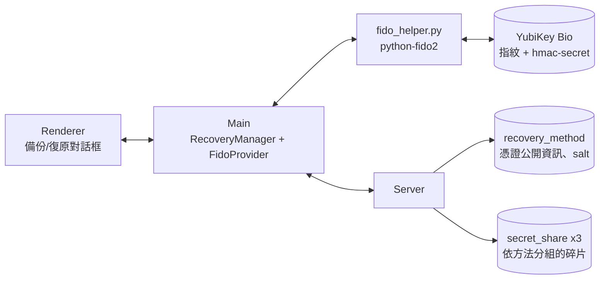

# 指紋帳號復原 計劃（最終版，高階）

- 日期：2026-09-15｜狀態：定案
- 硬體：YubiKey Bio（指紋型 FIDO2 安全金鑰，待採購）｜已購 Idem Key 作為 PIN 備援
- 已評估並放棄：MacBook Touch ID，因只能救同一台機器，不符合跨裝置復原

---

## 1. 目標

現況的帳號復原 = Email OTP + 備份密碼，可跨裝置。目標：**忘記密碼時，Email OTP + 指紋也能跨裝置復原**，密碼法保留作為另一個選項。

## 2. 核心觀念

指紋存在金鑰內，不上傳。金鑰在指紋比對通過後算出一個**固定的秘密值**，這個值取代密碼去導出解碎片的金鑰，之後的流程與密碼法完全相同。

| | 密碼法（現有） | 指紋法（新增） |
|---|---|---|
| 秘密在哪 | 使用者腦中 | YubiKey Bio 的安全晶片內 |
| 驗證動作 | 輸入密碼 | 插入金鑰、按指紋 |
| 導出金鑰 | 密碼 → HKDF → key | 金鑰秘密值 → HKDF → key |
| 雲端存什麼 | 三個 share DB 各一份加密碎片 | 一樣的碎片，另加憑證 ID 與 salt，兩者不是秘密 |
| 本機存什麼 | 沒有 | 沒有 |
| 跨裝置 | 可以 | 可以，金鑰隨身帶 |
| 遺失情境 | 忘記密碼救不回 | 金鑰遺失救不回，建議同時保留密碼法 |

論文用詞：「以安全金鑰經指紋驗證後產生之裝置秘密值取代密碼」。

## 3. 硬體

- **採購**：YubiKey Bio，FIDO Edition 或 Multi-protocol Edition 皆可，選 USB-C 版。名稱必須含「Bio」，YubiKey 5 系列沒有指紋。合理價格約 NT$3,000 到 3,800；需要發票可向台灣代理澄安國際購買。
- **前置設定**：先設 FIDO2 PIN，再登錄指紋。登錄可在我們的 App 內完成，或用 Yubico Authenticator。指紋連續錯 3 次退回 PIN，這是金鑰內建行為。
- **Idem Key**：沒有指紋感測器，以同一套程式接入，驗證動作為 PIN，作為第三種備援方法。

## 4. 架構



- 主程序透過 python-fido2 helper 直接操作金鑰。原因：Electron 在 macOS 上的 WebAuthn 沒有 PIN 輸入介面，正式版的 file 來源也不允許 WebAuthn。
- `FidoProvider` 介面只有兩個動作：綁定時導出秘密值、復原時按指紋重新導出同一個值。日後可換成瀏覽器 WebAuthn 而不影響其他部分。
- 碎片處理沿用現有程式：秘密值直接餵給 `encryptDataShareKey` / `recoverDataShareKey`，10 份碎片、存 3 份、門檻 2 不變。

## 5. 兩條流程

**綁定（已登入，帳號備份對話框選「指紋」）**

1. Server 發 challenge，金鑰建立憑證，Server 記下憑證公開資訊與隨機 salt。
2. 使用者按指紋，金鑰算出秘密值，Client 導出 extraKey。
3. 用 extraKey 加密私鑰資料並分割成碎片，送三個 share DB。

**復原（未登入，帳號復原對話框）**

1. 輸入 email、收 OTP、輸入 OTP。不變。
2. Server 回可用的復原方法，使用者選「指紋」。
3. Server 發 challenge，使用者插金鑰、按指紋，金鑰同時產生簽章與秘密值。
4. Server 驗證簽章與「已做使用者驗證」旗標，通過才釋出該方法的碎片。
5. Client 用秘密值導出 extraKey，解碎片，還原私鑰，登入。

## 6. 資料存放

| 資料 | 位置 |
|---|---|
| 指紋樣板、憑證私鑰、hmac-secret 秘密 | 金鑰內，不可匯出 |
| 憑證 ID、公鑰、salt、方法名稱 | Server 主 DB `recovery_method` |
| 碎片 | 三個 share DB `secret_share`，加 `method_id` 欄位，每個方法各一組 |
| 秘密值與 extraKey | 只在 Client 記憶體，用完即清 |

## 7. 安全性

- 復原需要三樣同時成立：email 信箱、實體金鑰、指紋或 PIN。
- 秘密值從不離開 Client，Server 與資料庫全部外洩也解不開碎片。
- 秘密值是 32 bytes 亂數等級，沒有密碼法的離線猜測風險。
- Server 端驗簽章：challenge 一次性、120 秒逾時、簽章計數器防複製。
- 代價：金鑰遺失或 PIN 累計錯 8 次鎖死即失去此方法，UI 強制提醒保留密碼法或綁第二支金鑰。

## 8. 實作階段

| 階段 | 內容 | 估時 |
|---|---|---|
| 0 到貨驗證 | 安裝 python-fido2，確認金鑰支援 hmac-secret 與指紋，跑腳本驗證同 salt 兩次秘密值相同 | 0.5 天 |
| 1 Client 核心 | `fido_helper.py`、`FidoProvider`、秘密值導出 extraKey | 1 到 2 天 |
| 2 Server | `recovery_method` 表、`secret_share` 加 `method_id`、綁定與復原事件、FIDO2 簽章驗證、OTP 後回方法清單 | 1 到 2 天 |
| 3 Client 流程 | `RecoveryManager`、IPC 與 preload、與登入流程整合 | 1 到 2 天 |
| 4 UI | 備份對話框加「指紋」與方法清單、復原對話框加方法選擇與指紋步驟、App 內指紋登錄與 PIN 設定 | 1 到 2 天 |
| 5 收尾 | 端到端測試、README、helper 打包 | 1 天 |

總計 6 到 9 個工作天，金鑰到貨後兩至三週內完成。Idem Key 在階段 1 就可以先接上用來開發，到貨後只是把驗證動作從 PIN 換成指紋。

## 9. 限制與風險

- 依賴 Python 3 與 fido2 套件，發布時需打包 helper。
- Windows 支援需另外驗證，python-fido2 在 Windows 非管理員模式走系統 WebAuthn API。
- 未驗證金鑰 attestation，可選用 AAGUID 白名單限制型號。
- 密碼法既有的弱 KDF 與 CBC 問題不在本計劃內。

## 10. 待你決定

1. 採購時間與管道。
2. 是否在 UI 強制要求保留密碼法。
3. Idem Key 是否保留作為備援方法。

## 附錄：到貨後的驗證步驟

```bash
pip3 install "fido2>=2.2"
brew install libfido2            # 選用，只為看金鑰資訊
fido2-token -L                   # 列出金鑰
fido2-token -I <裝置路徑>         # 確認 extensions 含 hmac-secret、options 含 bioEnroll
python3 scripts/fido_spike.py    # 建立憑證、兩次同 salt 秘密值相同、換 salt 不同、錯 PIN 回報次數
```
